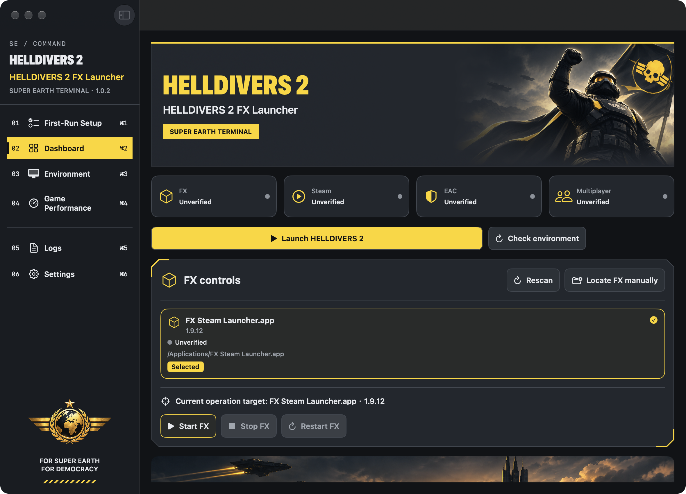
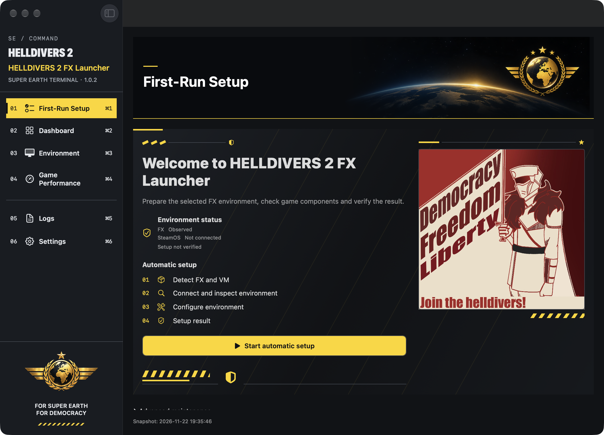
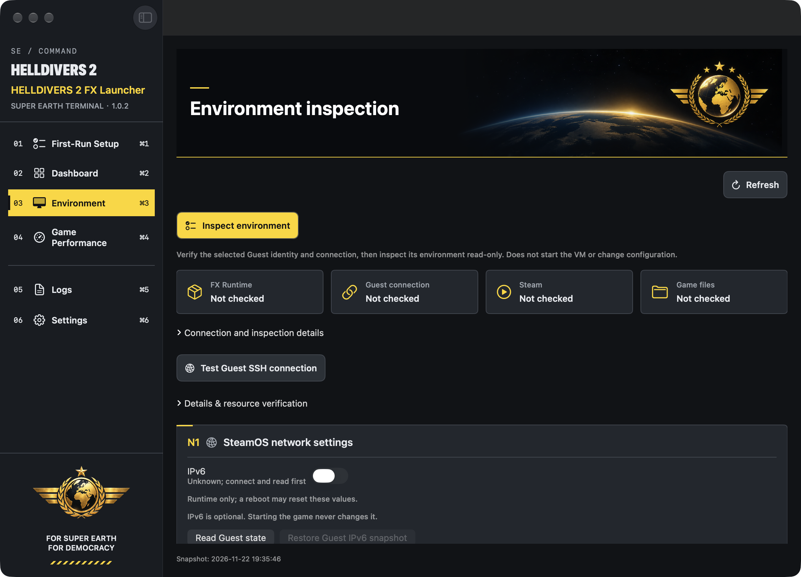
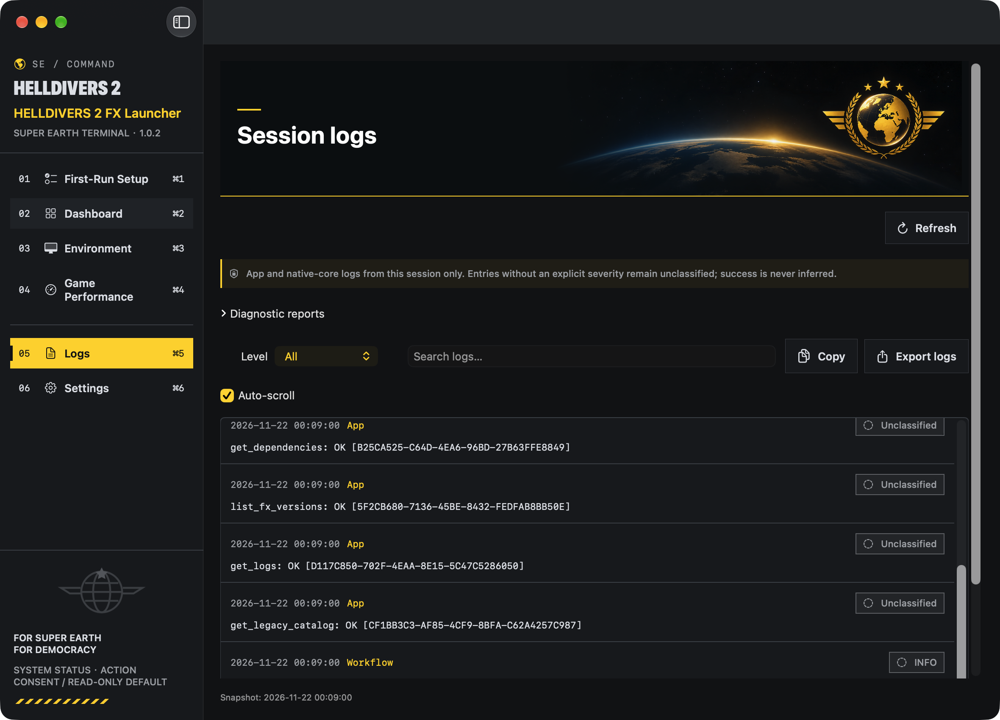
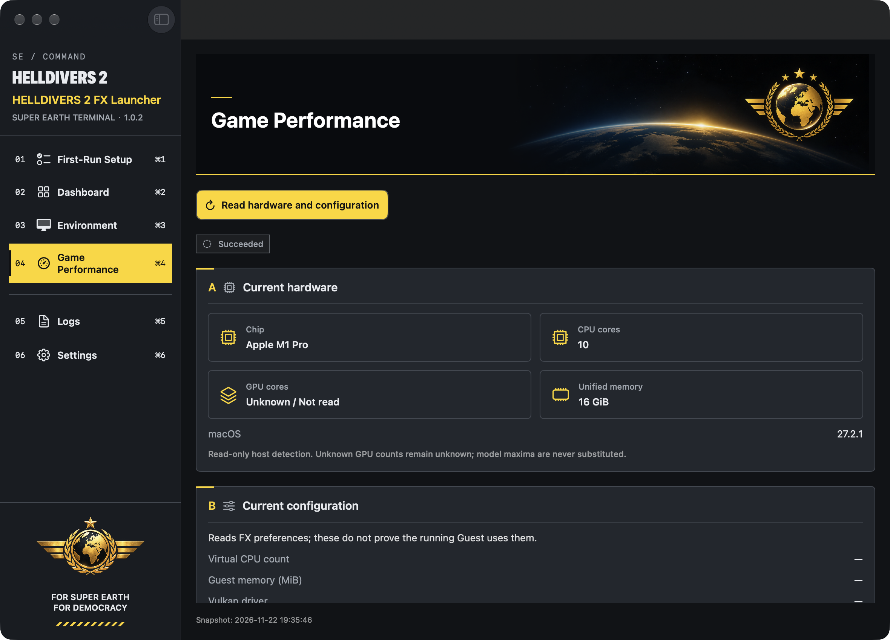
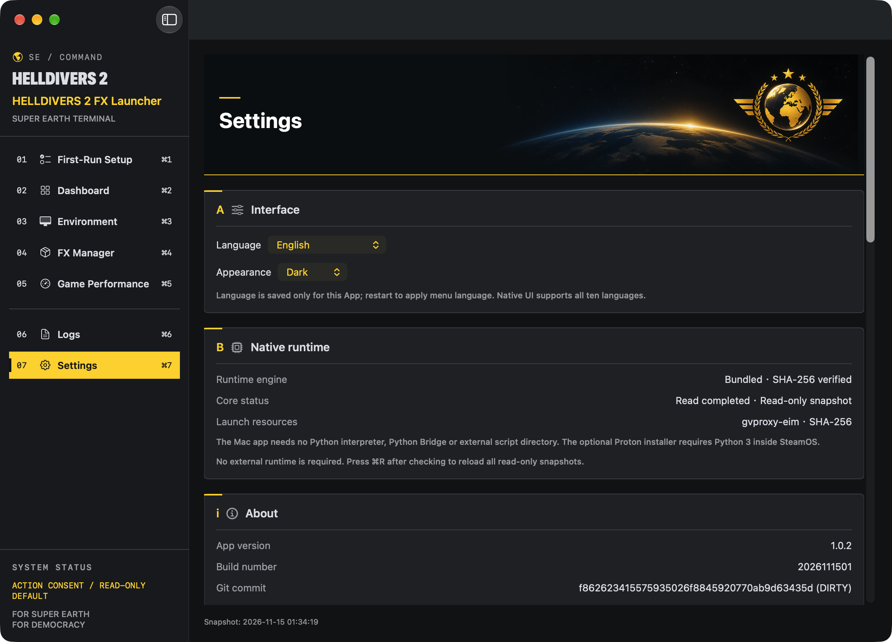

  
  <h1>HELLDIVERS 2 FX Launcher</h1>
  
HELLDIVERS 2 FX Launcher · Apple Silicon macOS

[简体中文](README.zh-CN.md) | [English](README.md)

<!-- stable-download:start -->
### [🟨 ⬇️ Download HD2 FX Launcher — Latest Stable](https://github.com/LSJOP/helldivers2-fx-launcher/releases/latest/download/HD2FXNative-v1.0.5-macOS-arm64.dmg)

**🟨 Stable Release · v1.0.5** · **macOS · Apple Silicon / arm64**

**[⬇️ Download DMG](https://github.com/LSJOP/helldivers2-fx-launcher/releases/latest/download/HD2FXNative-v1.0.5-macOS-arm64.dmg)** · [All Releases](https://github.com/LSJOP/helldivers2-fx-launcher/releases)
<!-- stable-download:end -->

## English

HELLDIVERS 2 FX Launcher is an unofficial community launcher and management tool for Apple Silicon Macs. Built with SwiftUI and a native core, it helps users inspect FX, configure the runtime environment and manage game performance settings.

FX 1.9.9 test-Guest repair now reaches the game through the GUI with the historically verified RF runtime components. Main menu/ship was confirmed by the user; single-player, multiplayer and end-to-end updating remain untested. Production FX 1.9.12 was inspected offline without writes. See [repair evidence](docs/environment/FX199_RF_REPAIR_20261114.md).

### Screenshots

Screenshots come from isolated Debug builds. The update panel capture uses a separate App identity and shows the service as unconfigured. See [capture provenance](docs/images/README.md).

Dashboard V003 consolidates FX controls and path-based selection, keeps advanced diagnostics in Environment, and hides scroll indicators while preserving scrolling. Four status cards show FX, Steam, EAC and multiplayer. Guest evidence remains in Environment.

| Dashboard | First-Run Setup |
| --- | --- |
|  |  |
| Environment | Logs |
|  |  |
| Game Performance | Settings |
|  |  |

### Features

Setup and launch workflow artwork is by **MOTR7**, used with the artist’s permission as supplied by the user. The Dashboard hero and shared page header are unchanged. The development candidate places First-Run Setup first in the sidebar (⌘1), while Dashboard remains the default (⌘2).

**Interface:** Environment and Logs use a shared content-area snapshot refresh. The Environment FX details section reuses inspection evidence to avoid repeated hashing during redraw.

The Logs page displays local system time, streams bounded task events, supports auto-scroll and exports redacted raw ISO 8601 timestamps. Launch command success, process detection, window and gameplay remain separate; game-window and gameplay evidence are not automatic.

- Dashboard starts the guarded HELLDIVERS 2 launch workflow. The Dashboard also manages FX selection and the supported FX launch action.
- First-Run Setup checks Guest identity, runtime capabilities and component integrity. Approved configuration can install the pinned Proton-JE package, select a verified Steam compatibility tool and merge launch options while retaining custom arguments. Detection is read-only. Deployment and recovery require their own checks.
- Environment reports FX runtime and Proton-JE evidence. SSH and sudo credentials can be stored separately in encrypted local storage for a verified target; reuse after restart still requires real-world acceptance.
- The Swift App provides six native pages, logs, scoped performance controls and ten interface languages. Optional SteamOS installation steps require Python 3.
- Use Settings → Software Update to check for stable releases. v1.0.1 cannot install the published v1.0.2 update ZIP, so install v1.0.2 using the DMG.

### Installation

<!-- stable-install:start -->
Current App: `1.0.5` (build `2026112501`), macOS 14+ Apple Silicon arm64. Ad-hoc signed; no Apple Developer ID signature or Apple notarization. Gatekeeper may block the download. Verify the [SHA-256 file](https://github.com/LSJOP/helldivers2-fx-launcher/releases/latest/download/SHA256SUMS.txt) before opening. If blocked, use Privacy & Security → Open Anyway for the verified App.
<!-- stable-install:end -->

1. Download the macOS arm64 DMG from the published release.
2. Run `shasum -a 256 <downloaded-dmg>` and compare the result with the SHA-256 in the release notes. Open the DMG after they match.
3. Drag the App to Applications.
4. Open the App.
5. Select an installed FX Steam Launcher in Dashboard and follow First-Run Setup. You need SteamOS with Steam and HELLDIVERS 2 (AppID 553850) installed under an account that owns the game. The Guest must be reachable over SSH. Enter required credentials in the App and review the proposed changes.
6. Choose **Launch HELLDIVERS 2** on Dashboard.

For source builds, see the [development guide](docs/NATIVE_DEVELOPMENT.md).

### Known Issues

Earlier FX 1.9.9 testing reached the game menu and ship. Single-player, EAC, multiplayer and fresh environment deployment remain unverified.

- FX and SteamOS compatibility depends on the selected build and runtime evidence. The current launch path has a recorded proxy mismatch. Safe FX stop/restart remains unavailable.
- A real Guest built an experimental FX runtime candidate. Its executable hash failed deployment review. Candidate installation, recovery and game compatibility remain unverified. Alternate Proton-JE builds and fresh SteamOS deployment require validation.
- First-run setup now enters automatic repair when the FX runtime is missing and distinguishes permission, executable, architecture, integrity and runtime failures. The public RF payload and verified fallback are still awaiting provenance and redistribution approval, so real fresh-user installation remains blocked rather than using an unreviewed binary.
- A historical Native build reached the game menu/ship on November 5. Final-package launch, single-player missions, EAC and multiplayer remain separately unverified.
- v1.0.1 rejects the published v1.0.2 update archive during ZIP safety checks. Use the DMG for this upgrade. Gatekeeper may block the ad-hoc signed, unnotarized App.
- [Acceptance report](docs/acceptance/RELEASE_READINESS_REPORT.md) · [Known issues detail](docs/acceptance/KNOWN_ISSUES.md) · [First-run acceptance](docs/testing/NATIVE_FIRST_RUN_ACCEPTANCE.md) · [Update integration](docs/NATIVE_UPDATES.md) · [Performance limits](docs/GAME_PERFORMANCE.md)

### Changelog

<!-- stable-version:start -->
[v1.0.5 — 2026-11-25](https://github.com/LSJOP/helldivers2-fx-launcher/releases/latest) · Stable release, build `2026112501`. See [release notes](CHANGELOG.md).
<!-- stable-version:end -->

For current feature status, verification and unmerged work, see the [feature registry](docs/FEATURE_REGISTRY.md), [changelog](CHANGELOG.md) and [original launcher history](https://github.com/LSJOP/helldivers2-fx-launcher/tree/legacy-script).

### Disclaimer

This community project is not affiliated with the makers of HELLDIVERS 2; names and marks belong to their respective owners. No project-wide source license has been selected. See [THIRD_PARTY_NOTICES.md](THIRD_PARTY_NOTICES.md) for third-party components and artwork.

### Documentation

User and developer guides, architecture notes and historical reports are available in the [documentation index](docs/README.md).

Development resumes from [current status](docs/DEVELOPMENT_STATUS.md) and [handoff](docs/NATIVE_APP_DEVELOPMENT_HANDOFF.md), with main source and AGENTS.md as authority. Unmerged candidates and live acceptance are tracked separately.

Interrupted native update transactions can be recovered on the next App launch.

FX 1.9.9 environment observations are recorded in the [runtime baseline report](docs/environment/FEX_BASELINE_REPORT_20261115.md).

First-run detection distinguishes a Proton-integrated FX runtime from a missing standalone runtime. It records the Proton version, config digest and library hashes, and reports compatibility as unverified until an approved plan is available.

v1.0.5 installs the component-update engine and provides a compact ZIP for existing Stable clients. Later compatible releases can reuse matching Bundle components and retain a verified full ZIP fallback. The three historical runtime payloads remain reserved for controlled testing. If in-app updating fails, mount the verified full DMG, quit the launcher, and replace the existing App. Your saved settings and SteamOS image remain in place. See [component update acceptance](docs/testing/COMPONENT_UPDATES_ACCEPTANCE.md).

The environment branch prefers verified FX runtime and Proton-JE resources in the App, with approved fixed-version downloads as fallback. Guest Steam manages Steam Linux Runtime 4.0. A missing Runtime requires a Steam connection, and a verified compatible installation is reused. Public FX and Proton-JE redistribution and real deployment acceptance remain pending. See the [deployment acceptance report](docs/testing/RF_FEX_BUNDLED_DEPLOYMENT_ACCEPTANCE.md).

Earlier recovery work installed the pinned Runtime through the isolated Debug replay (verified local archive or Valve HTTPS, SHA-256, SFTP, retained ARM64 Runtime, transaction recovery). Public one-click deployment remains blocked by RF binary provenance/redistribution review; the Debug replay requires explicitly supplied test image and resource paths. See [first-run acceptance](docs/testing/NATIVE_FIRST_RUN_ACCEPTANCE.md). The RF replay uses its own persistent directory and the audited empty RootFS registration. A no-game Runtime probe checks the selected RF executable and records its observed RootFS separately.

Persistence candidate: Steam was observed updating its runtime depot after reboot. The recovery branch now stages RF in an App-owned directory and verifies the real Runtime container RootFS. Main-window launch/reopen and current bilingual idle screenshots are repaired; final repeated-setup/reboot acceptance and lawful complete RF distribution remain pending.
