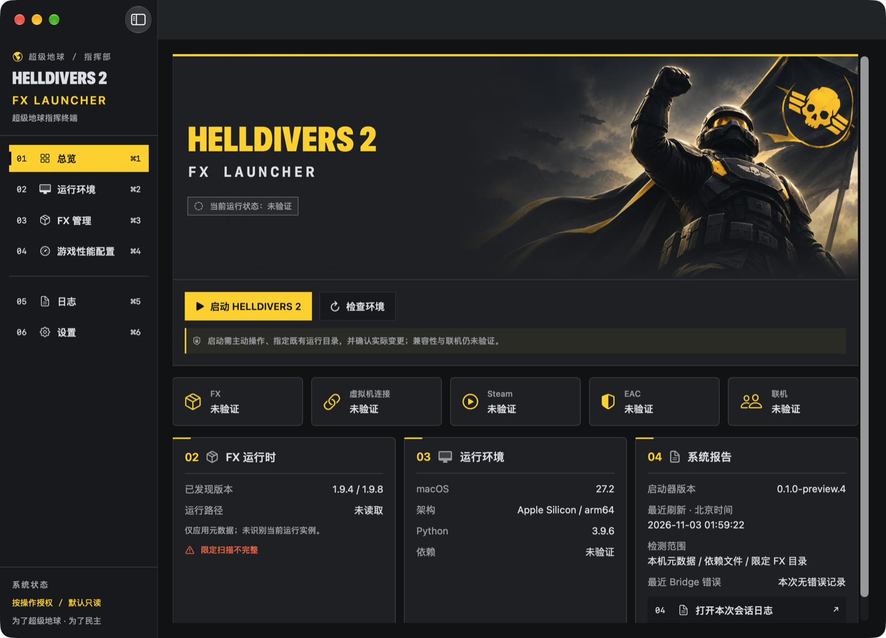
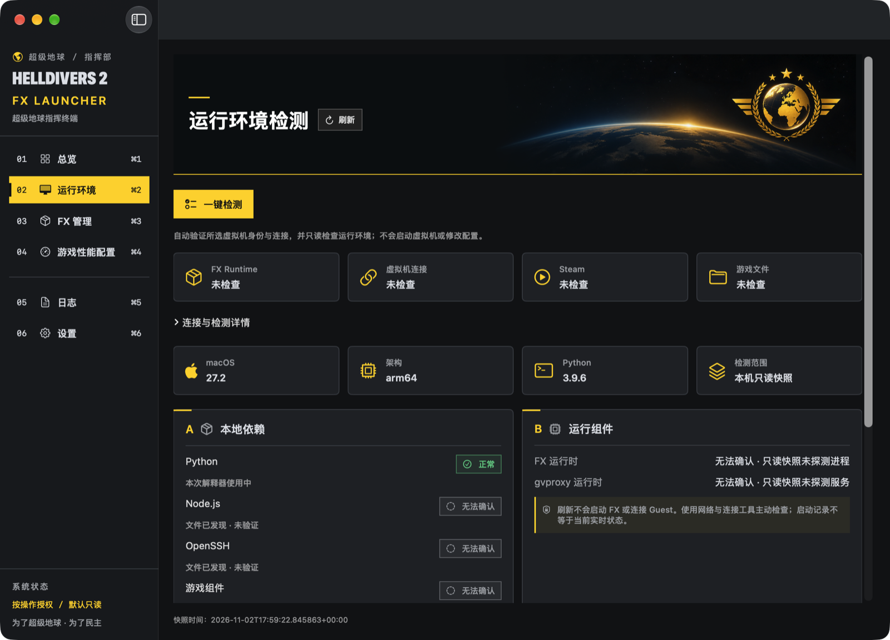
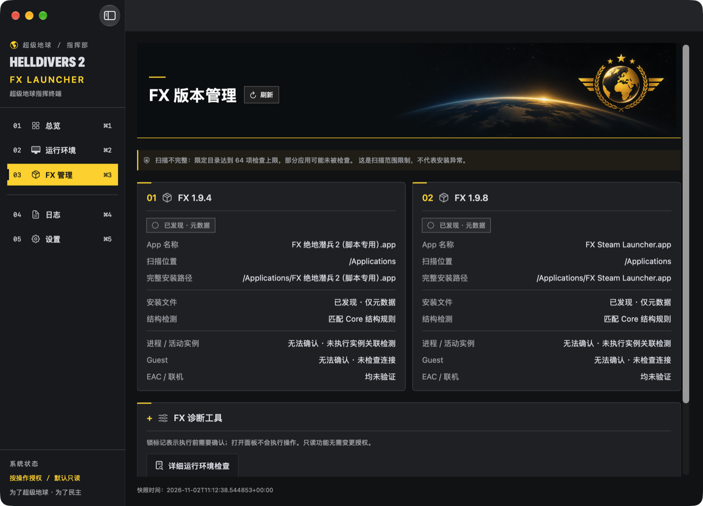
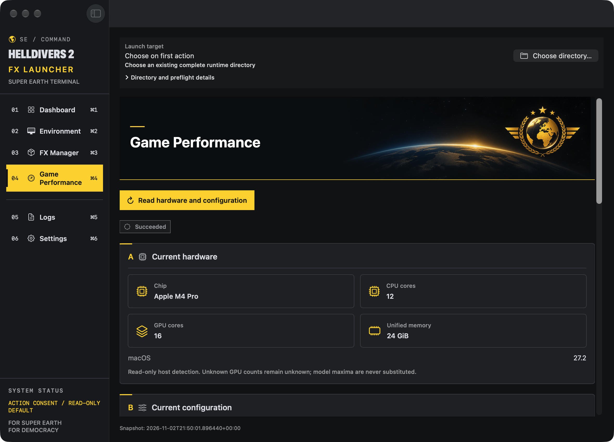

<div align="center">
  
  <h1>HELLDIVERS 2 FX Launcher</h1>
  <p>A HELLDIVERS 2 FX launcher and management tool for Apple Silicon Macs.</p>
</div>

<a id="english"></a>
<a id="简体中文"></a>

[**English**](README.md) | [**简体中文**](README.zh-CN.md)


[Screenshots](#en-screenshots) · [Features](#en-features) · [Installation](#en-installation) · [Quick start](#en-usage) · [Compatibility](#en-development) · [Legacy script](#en-legacy)

<a id="en-overview"></a>

A native **SwiftUI + AppKit** interface over the original Python Core: launch the game, inspect the selected FX environment and read performance settings from six focused pages. The interface defaults to dark, with inline operation feedback and advanced details available when needed.

> [!IMPORTANT]
> **Development preview.** No official installer has been released. The completed Native snapshot is integrated into [main](https://github.com/LSJOP/helldivers2-fx-launcher/tree/main); [feature/macos-native-app](https://github.com/LSJOP/helldivers2-fx-launcher/tree/feature/macos-native-app) is retained for development history. Runtime binaries, game files and Guest images are not included.

<a id="en-screenshots"></a>

## Screenshots

[](docs/images/dashboard.png)

| Environment | FX Manager |
| --- | --- |
| [](docs/images/environment.png) | [](docs/images/fx-manager.png) |

<details>
<summary>Game Performance</summary>

[](docs/images/performance.png)

</details>

Four actual Debug App window captures, taken on 2026-11-03 with real host metadata. Only proportional resizing was applied; no status or interface was composited. The FX image shows the operation area; additional content is accessible by scrolling. The supplied icon/illustrations are generated artwork rendered in the real App, not generated UI screenshots. These images do not prove Guest, game or multiplayer readiness.

<a id="en-features"></a>

## Features

| Status | Capability |
| --- | --- |
| 🟢 Implemented | Six-page native interface, Cmd+1…6 navigation, dark/light/system appearance, bundled official project icon |
| 🟢 Implemented | Bounded host/FX discovery; validated configuration editing with revision checks, backup and atomic replacement |
| 🟢 Implemented | Searchable, filtered, bounded and redacted logs; diagnostic reports |
| 🟢 Implemented · Read-only | Real chip/CPU/GPU/memory detection, current FX preferences and baseline differences in Game Performance |
| 🟠 In development | One-click environment inspection and background SSH operations; original-entry FX/Steam starts, independent SSH/sudo credential reuse; fresh live acceptance remains pending |
| 🟢 Implemented · Static coverage checked | Ten original Python catalogs retained separately; unified Native resources cover all ten languages. Missing Native text is shown as an explicit missing key, without English fallback. Translation naturalness still needs human review |
| ⚪ Planned / unavailable | Safe FX stop/restart, writable inferred performance profiles with scoped restore, signed/notarized installer |

Performance rules are local and reproducible. The recorded **M4 Pro / 24 GiB** settings are a candidate baseline, not comprehensive performance validation. Other hardware has no inferred writable profile. Apply/restore are disabled with visible reasons. [Parameter sources and limits](docs/GAME_PERFORMANCE.md).

<a id="en-requirements"></a>
<a id="en-installation"></a>

## Download and installation

**An official installer has not been released.** The repository [Releases page](https://github.com/LSJOP/helldivers2-fx-launcher/releases) currently has no published release; this is not a download button for a nonexistent package.

Source preview requirements: **Apple Silicon, macOS 14+, a complete Xcode/macOS SDK and Python 3.9+**. Game operations also require the existing complete legacy launcher directory, the original validated FX/gvproxy assets and compatible Guest access.

```sh
git clone --branch main --recurse-submodules https://github.com/LSJOP/helldivers2-fx-launcher.git
cd helldivers2-fx-launcher/native-app
./script/build_and_run.sh --xcode-only
open build/Debug/HD2FXNative.app
```

Existing clones need the intended branch and `git submodule update --init --recursive`. Source ZIPs omit the pinned Core submodule. See the [development guide](docs/NATIVE_DEVELOPMENT.md).

<a id="en-usage"></a>

## Quick start

1. Open the App; choose your language, appearance and existing Python interpreter in Settings.
2. Select the existing launcher directory on first use. Use **Inspect environment** for read-only Guest checks; FX must already be running. Use **Start FX** in FX Manager if needed.
3. Click **Launch HELLDIVERS 2** on Dashboard. The existing launch workflow performs its required checks automatically. Review start consent and any exact configuration-change preview; enter credentials only in App secure fields.
4. Use Game Performance for hardware and baseline comparisons, and Logs for failure details. A detected process does not establish arrival at the game menu.

<a id="en-development"></a>

## Compatibility status

| Evidence | Current result |
| --- | --- |
| Native App | Debug build and six-page smoke passed; current focused checks: 35 migration + 9 inference cases |
| FX / game process | Observed during the earlier recorded dedicated FX 1.9.4 launch; not a claim about every FX installation |
| Main menu / controllable ship | Explicitly confirmed by the user on 2026-11-03 in that recorded environment |
| Current GUI SSH / Guest read | Real backends wired; latest host check rejected a different running FX copy before connecting. Fresh success through the new actions remains pending |
| Single-player mission / independent EAC / multiplayer | **Unverified**, separately |
| Performance | Read-only candidate comparison; no measured performance guarantee or automatic tuning |

> [!WARNING]
> Installation found ≠ runtime ready ≠ game process started ≠ main menu reached ≠ EAC accepted ≠ multiplayer working. No anti-cheat bypass is provided.

## FAQ

- **Why are stop/restart or Apply disabled?** A verified graceful-exit backend and safe inferred-profile write/restore bounds are not available. The App does not force-stop or silently reconfigure FX.
- **Must I retype passwords?** Session reuse is the default. Optional remembering stores independently verified SSH/sudo credentials in a new App-owned macOS Keychain namespace; automatic reads suppress authorization dialogs. Locked/access-restricted storage falls back to secure input. Explicit access or App identity/signature changes may still require system authorization. Old script items are untouched.
- **Are automatic updates ready?** Sparkle 2 is integrated, but a signed feed/release service is not configured. Update checks remain disabled; installation is unverified.

<a id="en-legacy"></a>

## Development and legacy script

- [main](https://github.com/LSJOP/helldivers2-fx-launcher/tree/main): integrated Native mainline.
- [feature/macos-native-app](https://github.com/LSJOP/helldivers2-fx-launcher/tree/feature/macos-native-app): retained Native development history; synchronize with main before reuse.
- [legacy-script](https://github.com/LSJOP/helldivers2-fx-launcher/tree/legacy-script): original script archive; its history is preserved.
- [Development guide](docs/NATIVE_DEVELOPMENT.md) · [Migration evidence](docs/FUNCTION_MIGRATION.md) · [Performance](docs/GAME_PERFORMANCE.md) · [Updates](docs/NATIVE_UPDATES.md) · [Development rules](AGENTS.md)

<a id="en-disclaimer"></a>
<a id="en-license"></a>

## Disclaimer and license

Unofficial project; no endorsement or compatibility guarantee. HELLDIVERS 2 and related marks belong to their respective owners. A project-wide source license has **not been selected**; do not assume redistribution rights. See [rights and provenance](THIRD_PARTY_NOTICES.md), including the separate Sparkle license and supplied artwork notes.

Development checks: `python3 native-app/script/check_localization.py` reports ten-language key/format coverage and README review candidates; `native-app/script/run_checks.sh` and the pre-commit hook include this gate. UI changes require a review of both READMEs and their real screenshots. Current screenshots precede this localization repair; localized variants still need fresh capture. No CI workflow is configured.
