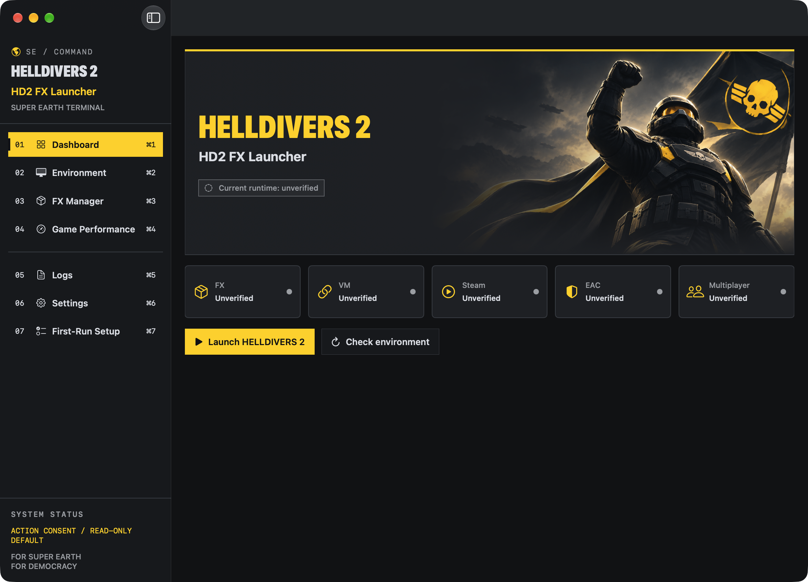
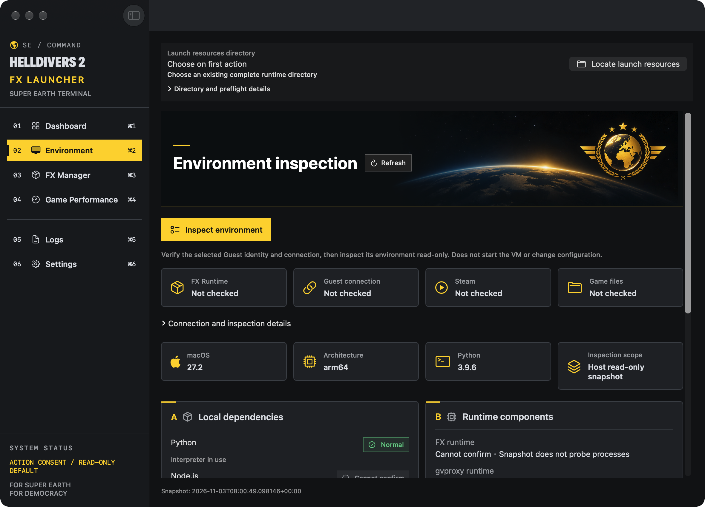
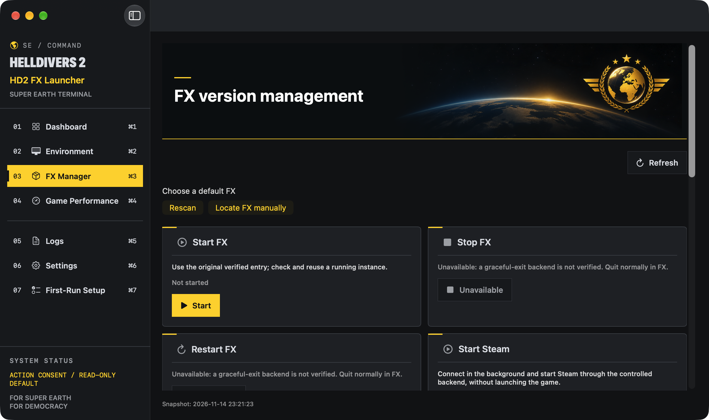
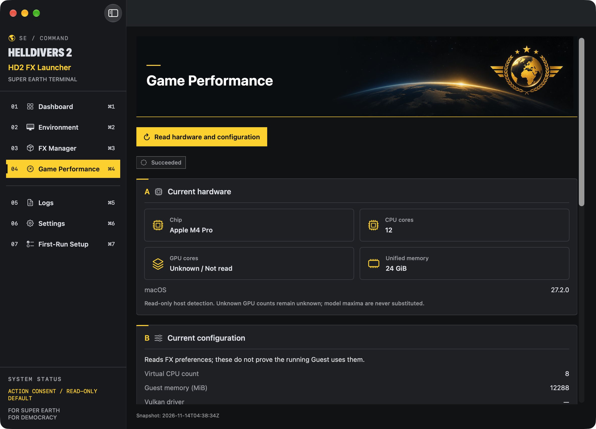
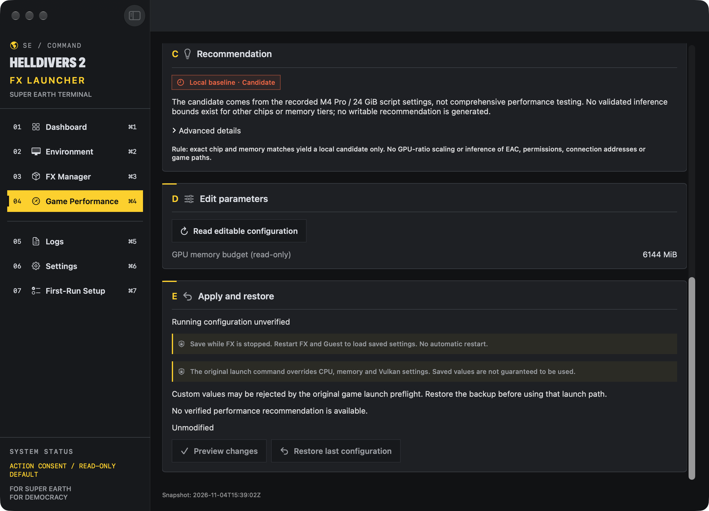
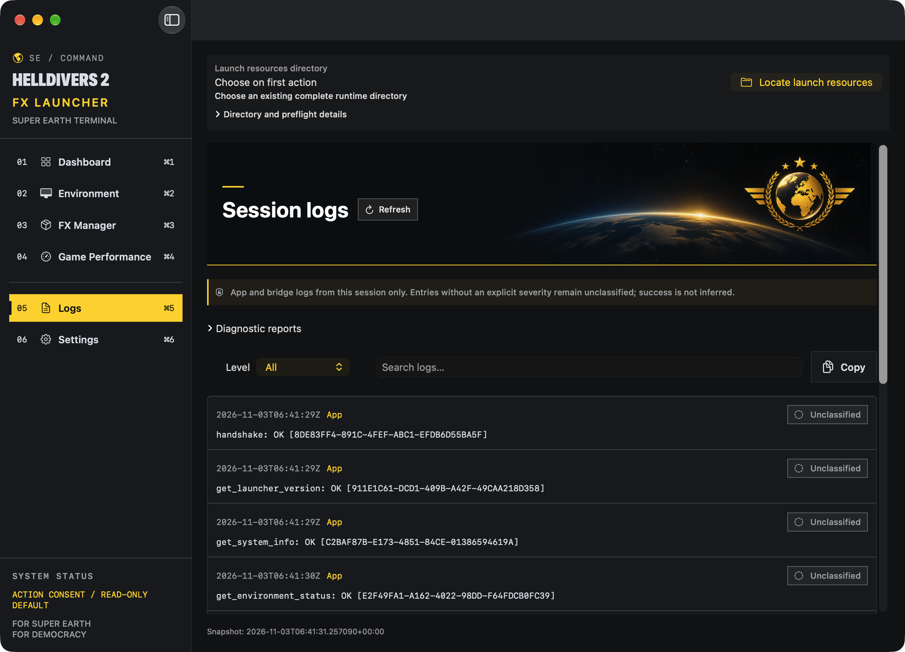
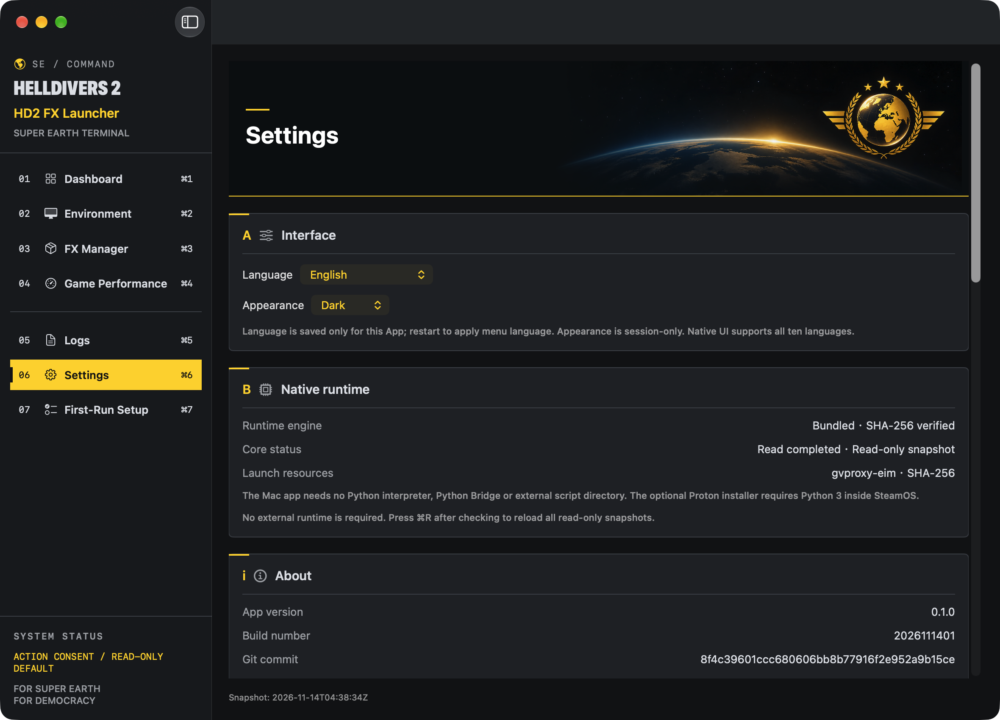
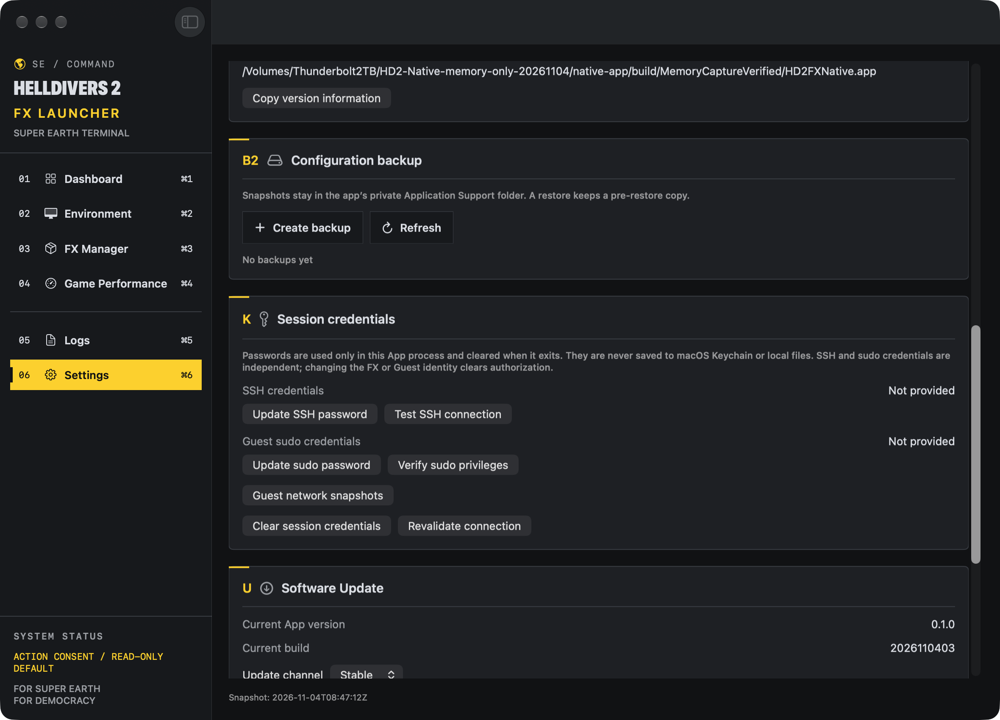
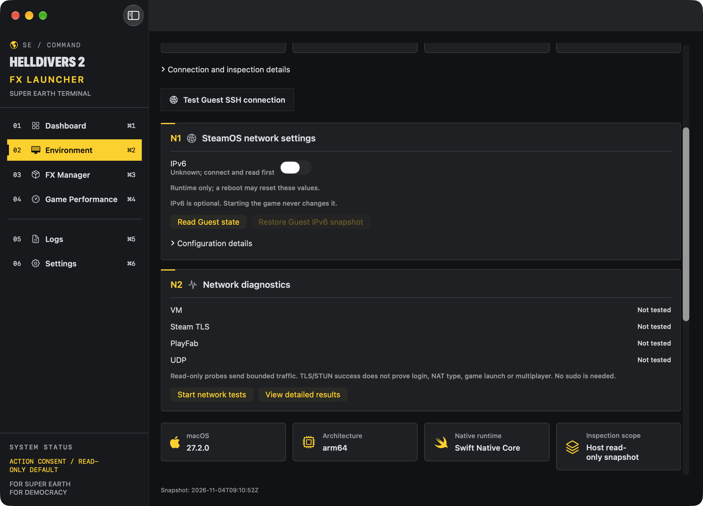
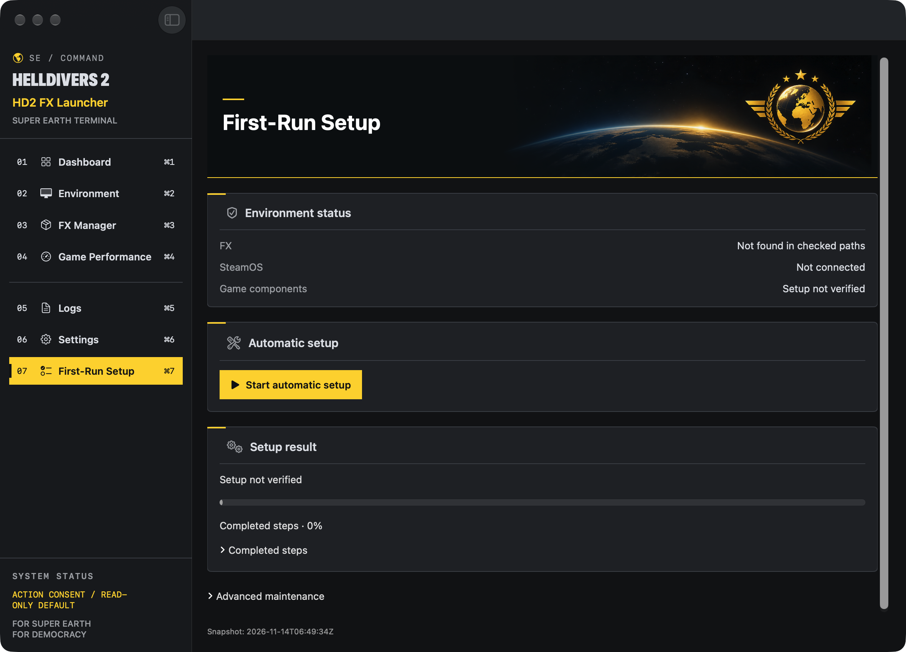

<div align="center">
  
  <h1>HELLDIVERS 2 FX Launcher</h1>
  <p>A HELLDIVERS 2 FX launcher and management tool for Apple Silicon Macs.</p>
</div>

<a id="english"></a>
<a id="简体中文"></a>

[**English**](README.md) | [**简体中文**](README.zh-CN.md)


[Screenshots](#en-screenshots) · [Features](#en-features) · [Installation](#en-installation) · [Quick start](#en-usage) · [Compatibility](#en-development) · [Changelog](#en-changelog) · [Legacy script](#en-legacy)

### First-run environment setup (isolated development build)

Open **First-Run Setup**, choose FX, enter separate session-only SSH/sudo passwords, then connect and inspect. Review the detected target, profile and exact changes before selecting **Configure environment**. Close Steam/game yourself before offline configuration writes. Correct managed settings are skipped on subsequent scans. Recovery loads only this app’s receipts, compares current values, and stops on identity changes or external edits.

The candidate matrix is FX **1.9.8** / SteamOS **0.4.5** / **aarch64** / AppID **553850**. It is a historical target, not a promise that all installations have identical components. FEX and Proton-JE distribution is **BLOCKED** until reviewed packages, full manifests, hashes, provenance and licenses are available. No private VM files are distributed. The initial profile never forces a proxy, gvproxy replacement, IPv4-only, CPU affinity or historical CPU/RAM/GPU budgets. Hardware/FX recommendations use the existing guarded Performance page.

Component sources, recovery rules, common errors and test boundaries are recorded in [implementation](NATIVE_FIRST_RUN_DEPLOYMENT_IMPLEMENTATION.md), [profile matrix](NATIVE_ENVIRONMENT_PROFILE_MATRIX.md), [security review](NATIVE_DEPLOYMENT_SECURITY_REVIEW.md), [test results](NATIVE_DEPLOYMENT_TEST_RESULTS.md) and [acceptance](NATIVE_FIRST_RUN_ACCEPTANCE.md). Missing/unsupported versions require a new reviewed profile; `ARTIFACT_UNAPPROVED` means no installation attempt, `STEAM_RUNNING` requires closing Steam and rescanning, and `RECOVERY_REQUIRED` blocks further deployment until the recorded change is resolved. A successful configuration receipt does not validate gameplay, EAC or multiplayer. New VM acceptance is **NOT_TESTED**. Latest is unchanged.


<a id="en-overview"></a>

A fully native **SwiftUI + AppKit** app with a **Swift Native Core**: launch the game, inspect the selected FX environment and manage performance settings from seven focused pages. No Python interpreter, Python Bridge or external script directory is used at runtime. The interface defaults to dark, with inline operation feedback and advanced details available when needed.

> [!IMPORTANT]
> **Development preview.** No official installer has been released. The completed Native snapshot is integrated into [main](https://github.com/LSJOP/helldivers2-fx-launcher/tree/main); [feature/macos-native-app](https://github.com/LSJOP/helldivers2-fx-launcher/tree/feature/macos-native-app) is retained for development history. Runtime binaries, game files and Guest images are not included.

<a id="en-screenshots"></a>

All seven pages open directly into their content; the repeated global FX status bar has been removed. FX detection, versions, running state and resource diagnostics remain in FX Manager and Environment.

## Screenshots

**Native takeover preview:** Guest SSH now uses a controlling terminal and corrected OpenSSH arguments, with a dedicated read-only **Test Guest SSH connection** action in Environment. Enter credentials only in App secure fields. Settings → About displays bundled build identity and can copy it. Live Guest password authentication and gameplay still require user acceptance; isolated checks are not live validation. Environment and Settings screenshots were refreshed from the real Debug App on 2026-11-04; offscreen About values are checked separately during Release acceptance. All page screenshots now show the current simplified layout. The SSH-only check can inspect an already-running stock FX network process after publisher-signature and ancestry verification; game launch still requires the pinned bundled backend.

All seven pages and the performance/update detail viewports were recaptured on 2026-11-04 after the shared global FX status bar was removed. No replacement bar or reserved space is present.

[](docs/images/en/dashboard.png)

| Environment | FX Manager |
| --- | --- |
| [](docs/images/en/environment.png) | [](docs/images/en/fx-manager.png) |

<details>
<summary>Game Performance</summary>

[](docs/images/en/performance.png)

[](docs/images/en/performance-actions.png)

</details>
<details>
<summary>Logs, Settings and Software Update</summary>

[](docs/images/en/logs.png)
[](docs/images/en/settings.png)
[](docs/images/en/settings-updates.png)

</details>


Ten current English screenshots come from the actual integrated Debug App (0.1.0, build 2026110411), covering seven pages, network settings and scrolled settings. Original pixels are unmodified; capture copies isolate preferences and do not connect to or change Guest state. Screenshots do not establish gameplay or installation acceptance. [Capture provenance](docs/images/README.md).

<a id="en-features"></a>

## Features

| Status | Capability |
| --- | --- |
| 🟢 Implemented | Seven-page native interface, Cmd+1…7 navigation, dark/light/system appearance, bundled official project icon |
| 🟢 Implemented | Bounded host/FX discovery; validated configuration editing with revision checks, backup and atomic replacement |
| 🟢 Implemented | Searchable, filtered, bounded and redacted logs; diagnostic reports |
| 🟢 Implemented · Guarded writes | Hardware/current FX preferences and reference differences; scoped performance editing/backup/restore for the pinned FX 1.9.4 build |
| 🟠 In development | One-click environment inspection and background SSH operations; original-entry FX/Steam starts, independent SSH/sudo credential reuse; fresh live acceptance remains pending |
| 🟢 Implemented · Static coverage checked | Ten original Python catalogs retained separately; unified Native resources cover all ten languages. Missing Native text is shown as an explicit missing key, without English fallback. Translation naturalness still needs human review |
| ⚪ Planned / unavailable | Safe FX stop/restart, verified performance recommendations, signed/notarized installer |

Performance rules are local and reproducible. The recorded **M4 Pro / 24 GiB** settings are a candidate baseline, not comprehensive performance validation. Other hardware has no inferred writable profile. Verified FX 1.9.4 and 1.9.8 builds support a conservative CPU/memory/Vulkan/Metal HUD editor with preview, consent, verified backups and conflict-guarded restore. FX must be stopped; saved preferences need a fresh FX/Guest start and remain unverified. The original launch path overrides values and may reject custom settings: restore before using it. Super resolution and the 6144 MiB GPU budget remain read-only. Current localized screenshots include the new performance and update surfaces. [Parameter sources and limits](docs/GAME_PERFORMANCE.md).

<a id="en-requirements"></a>
<a id="en-installation"></a>

## Download and installation

**An official installer has not been released.** The repository [Releases page](https://github.com/LSJOP/helldivers2-fx-launcher/releases) currently has no published release; this is not a download button for a nonexistent package.

Source preview requirements: **Apple Silicon, macOS 14+ and a complete Xcode/macOS SDK**. Game operations require an installed, publisher-signed FX Steam Launcher and a running FX Guest reachable over SSH. Launch networking resources (gvproxy) are bundled and SHA-256 verified.

```sh
git clone --branch main --recurse-submodules https://github.com/LSJOP/helldivers2-fx-launcher.git
cd helldivers2-fx-launcher/native-app
./script/build_and_run.sh --xcode-only
open build/Debug/HD2FXNative.app
```

Existing clones need the intended branch and `git submodule update --init --recursive`. Source ZIPs omit the pinned Core submodule. See the [development guide](docs/NATIVE_DEVELOPMENT.md).

<a id="en-usage"></a>

## Quick start

1. Open the App; choose your language and appearance in Settings, then select the installed FX Steam Launcher in FX Manager.
2. The Native App uses bundled resources; no script directory is required. Use **Inspect environment** for read-only Guest checks; FX must already be running. Use **Start FX** in FX Manager if needed.
3. Click **Launch HELLDIVERS 2** on Dashboard. The existing launch workflow performs its required checks automatically. Review start consent and any exact configuration-change preview; enter credentials only in App secure fields.
4. Use Game Performance for hardware and baseline comparisons, and Logs for failure details. A detected process does not establish arrival at the game menu.

<a id="en-development"></a>

## Compatibility status

| Evidence | Current result |
| --- | --- |
| Native App | Debug build and seven-page capture passed; current focused checks: 35 migration + 9 inference cases |
| FX / game process | Observed during the earlier recorded dedicated FX 1.9.4 launch; not a claim about every FX installation |
| Main menu / controllable ship | Explicitly confirmed by the user on 2026-11-03 in that recorded environment |
| Current GUI SSH / Guest read | Real backends wired; latest host check rejected a different running FX copy before connecting. Fresh success through the new actions remains pending |
| Single-player mission / independent EAC / multiplayer | **Unverified**, separately |
| Performance | Guarded saved-preference editing with backup/restore; no measured performance guarantee or automatic tuning |

> [!WARNING]
> Installation found ≠ runtime ready ≠ game process started ≠ main menu reached ≠ EAC accepted ≠ multiplayer working. No anti-cheat bypass is provided.

<a id="en-changelog"></a>

## Changelog

No official release has been published yet; the current Native version `0.1.0` is a development preview. Recent unreleased changes:

- Native seven-page interface, bounded FX discovery, validated configuration editing, redacted logs and read-only performance comparison.
- GUI-driven FX/SSH actions and independent, memory-only SSH/sudo session credentials.
- Sparkle 2 update integration (feed/signing service not configured).

See the full history in [CHANGELOG.md](CHANGELOG.md).

## FAQ

- **Why are stop/restart or some Apply actions disabled?** Graceful exit is unverified. Performance editing requires the pinned FX 1.9.4 build, valid preferences, stopped FX and explicit preview/consent. Invalid backups or external changes block restore. The App does not force-stop FX.
- **Must I retype passwords?** SSH and sudo passwords are independent and reused only during this App process. They are never stored in macOS Keychain, preferences or local files. Fully quitting the App requires reentry; changing FX/Guest identity clears authorization. Old saved items are neither read, migrated nor deleted.
- **Are automatic updates ready?** Manual GitHub Native-release checks work in Settings → Software Update. Stable is the default; Preview and automatic checks remain closed until verified service setup. A verified-download backend requires a trusted Ed25519 key and signed manifest; installation remains disabled without the signed Appcast, Developer ID and notarization/distribution conditions. Manual checks never install automatically. The automatic-check toggle stays disabled until the signed service is ready. Download verification includes signature, size and SHA-256; installation stays with official Sparkle. No production update package is published yet. Failures leave the current App intact; no installed/relaunched success is inferred. Release preparation verifies signed feed history before reusing it. [Setup and release gates](docs/NATIVE_UPDATES.md).

<a id="en-legacy"></a>

## Development and legacy script

- [main](https://github.com/LSJOP/helldivers2-fx-launcher/tree/main): integrated Native mainline.
- [feature/macos-native-app](https://github.com/LSJOP/helldivers2-fx-launcher/tree/feature/macos-native-app): retained Native development history; synchronize with main before reuse.
- [legacy-script](https://github.com/LSJOP/helldivers2-fx-launcher/tree/legacy-script): original script archive; its history is preserved.
- [Development guide](docs/NATIVE_DEVELOPMENT.md) · [Migration evidence](docs/FUNCTION_MIGRATION.md) · [Performance](docs/GAME_PERFORMANCE.md) · [Updates](docs/NATIVE_UPDATES.md) · [Development rules](AGENTS.md)

<a id="en-disclaimer"></a>
<a id="en-license"></a>

## Disclaimer and license

Unofficial project; no endorsement or compatibility guarantee. HELLDIVERS 2 and related marks belong to their respective owners. A project-wide source license has **not been selected**; do not assume redistribution rights. See [rights and provenance](THIRD_PARTY_NOTICES.md), including the separate Sparkle license and supplied artwork notes.

Development checks: `native-app/script/run_checks.sh` compiles and runs the native-core contract checks plus ten-language and documentation gates. Python is used only by optional developer scripts; the app bundle and runtime contain no Python. UI changes require a review of both READMEs and their real screenshots. Both English and Simplified Chinese screenshots are refreshed for the integrated UI. Translation naturalness still needs human review. The release-check Actions template remains inactive; no CI workflow is configured.

FX selection V2 + automatic selection V2.1: the FX page, overview and launch panel share one persisted default. One identity/path-verified FX is selected automatically from the scan results; multiple installations preserve an existing valid choice or require selection. Missing/moved/updated defaults are revalidated. Selection remains **launch capability unverified** and never starts the game. Every game launch rescans the default and freezes one selected FX path for inspection, preflight and execution. Integrity accepts the exact historical build or an intact bundle signed by the verified FX publisher (Apple trust anchor, Bundle ID and Team ID), rechecks the verified digest and retains all original profile, process and Guest guards. This does not establish gameplay compatibility. Launch resources are bundled in the Native App; no original script directory or Node helper is required. Stop/restart remain unavailable. Scoped performance editing supports verified FX 1.9.4/1.9.8 while stopped, with explicit preview and confirmation; FX 1.9.9 writes remain unsupported.

Launch resources: the Native bundle includes SHA-256-verified gvproxy and wrapper resources. Missing, altered or symlinked resources fail closed; no FX files are changed. Host discovery is checked separately from Guest and gameplay compatibility.

Sudo investigation (2026-11-04): build 2026110402 has a remote empty-prompt quoting defect. The fix and distinct sudo/SSH failure classification are under validation; no replacement build is released. Full Guest identity passed a live read-only check; passworded sudo and subsequent launch stages remain unverified.

**Current credential implementation:** Main retains Guest identity binding, independent SSH/sudo memory credentials, per-call authorization and redaction; First-Run Setup uses the same service. Live privileged changes, fresh VM, gameplay and multiplayer remain NOT_TESTED. Current captures use integrated build 2026110411.


**SteamOS network candidate (unreleased):** Environment → SteamOS network settings provides explicit runtime IPv6 enable/disable, exact confirmation, backup and verified recovery. IPv6 is optional and game startup never changes it. VM, Steam TLS, PlayFab and UDP diagnostics are explicit read-only probes without sudo; passing does not verify multiplayer. Credentials remain memory-only. Real Guest writes and game launch remain NOT TESTED. [Network guide](docs/STEAMOS_NETWORK_SETTINGS.md) · [Python → Swift parity](docs/PYTHON_TO_SWIFT_FEATURE_PARITY_AUDIT.md).

[](docs/STEAMOS_NETWORK_SETTINGS.md)



[First-run integration and Latest build record](NATIVE_FIRST_RUN_MAIN_MERGE_REPORT.md).

Acceptance in progress: selected FX entries are deduplicated against automatic discovery. FX 1.9.9 is installed and discoverable but performance writes are unsupported; real Guest/game acceptance and formal distribution remain pending. See [acceptance report](docs/acceptance/FULL_SYSTEM_ACCEPTANCE_REPORT.md).
