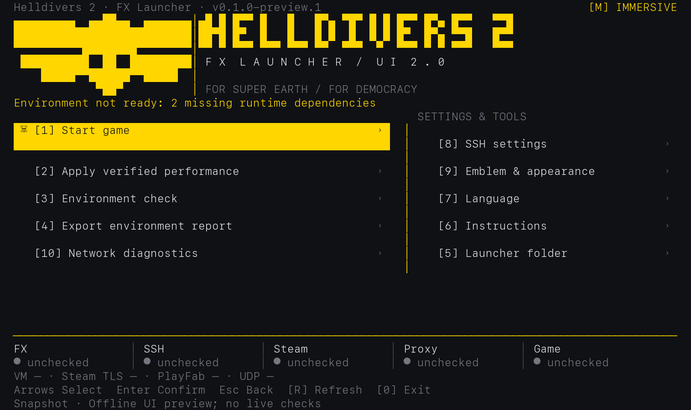

# HELLDIVERS 2 · Mac 启动助手 / Mac Launcher

[简体中文](#简体中文) · [English](#english)

<!-- launcher-version:start -->
**当前源码版本 / Current source version: `0.1.0-preview.1`** · [VERSION](VERSION) · [CHANGELOG](CHANGELOG.md)
源码技术预览；尚无完整安装包，版本号不代表已创建 GitHub Release。 / Source technical preview; no complete installer or GitHub Release is implied.
<!-- launcher-version:end -->



*当前 UI 代码的离线渲染预览，不是游戏运行或联机成功截图。 / Offline preview rendered from the current UI code; no game, EAC or multiplayer success is implied.* [中文界面 / Chinese UI](docs/images/launcher-zh-CN.png) · [截图来源 / Image provenance](docs/images/README.md)

**源码技术预览 / Source Technical Preview**

兼顾开发者交流与玩家使用，逐步走向普通玩家可安装的启动器。当前完整安装流程尚未完成。 / A project for developer collaboration and players, progressing toward an installable launcher. Full setup for new players is not ready yet.

| 下载类型 / Download | 当前提供什么 / What it contains | 适用对象 / Audience |
| --- | --- | --- |
| 源码技术预览 / Source Preview | 本仓库源码、双语教程和启动入口；不含完整虚拟机或兼容组件 / Source, bilingual guide and shortcuts; no complete VM or compatibility package | 开发者及体验菜单的玩家；运行游戏需匹配环境 / Developers and players exploring the UI; gameplay needs a matching environment |
| 完整可安装版本 / Complete installer | **尚未提供 / Not available**；自动准备依赖与跨机器安装仍待实现 / Automated setup and fresh-machine installation are unfinished | 未来面向新玩家 / Intended for new players in a future release |

[依赖 / Dependencies](docs/DEPENDENCIES.md) · [已测试环境 / Compatibility](docs/COMPATIBILITY.md) · [架构 / Architecture](docs/ARCHITECTURE.md) · [贡献 / Contributing](CONTRIBUTING.md) · [发布计划 / Roadmap](docs/ROADMAP.md) · [第三方与许可证 / Third-party review](THIRD_PARTY_NOTICES.md)

## 简体中文

### 项目状态与参与方式

现有源码包括终端菜单、十种界面语言、SSH 连接与可选钥匙串密码存储、本地依赖检查、运行状态和网络诊断。自动安装兼容组件、通用 FX 路径识别、直连／自定义代理适配尚未实现。

| 项目 | 证据与状态 |
| --- | --- |
| 当前入口与界面 | 本地离线检查通过；不是游戏启动验证。 |
| M4 Pro / 24 GiB / macOS 27.2，专用补丁环境 | 历史单机启动记录与用户联机反馈；不是当前下载包的全新安装验证。 |
| 其他 Mac、其他系统、普通 FX 全新安装 | 未验证；不标记为支持。 |

完整范围见[兼容性表](docs/COMPATIBILITY.md)。开发者请先读[架构](docs/ARCHITECTURE.md)和[贡献指南](CONTRIBUTING.md)；玩家可按[安装、启动、联机或功能建议分类](https://github.com/LSJOP/helldivers2-fx-launcher/issues/new/choose)提交问题。Preview → Beta → Stable 的验收门槛见[发布计划](docs/ROADMAP.md)，这些阶段不代表已经发布了安装包。

### 先看这里：现在能直接玩吗？

**当前下载包还不能让一台全新的 Mac 直接运行游戏。** 它需要匹配的 FX 虚拟机和兼容组件，而完整组件包及自动安装流程还在准备中。只下载普通 FX 并不够。

第一次安装也可以直接打开 UI 2.0 主菜单。缺少 FX、虚拟机网络组件、Node.js 或 SSH 时进入受限模式，语言切换、外观设置、使用说明、本地环境检查和报告导出仍可使用。启动游戏或一键环境配置时会重新检查；完整游戏环境仍需匹配组件。

已有相同兼容环境的玩家，可以继续下面的步骤。这里不包含游戏，需使用自己的 Steam 账号与游戏。

### 第 1 步：下载完整文件夹

1. 在本页上方点击绿色的 **Code** 按钮。
2. 选择 **Download ZIP**，下载完成后双击 ZIP 解压。
3. 把解压后的整个文件夹放到你方便找到的位置，例如“文稿”。

请保留整个文件夹；启动文件需要用到旁边的其他文件。

### Python / Node.js 一键准备

解压到默认“下载”文件夹后，可复制：

```sh
cd "$HOME/Downloads/helldivers2-fx-launcher-main" && /bin/bash tools/install_dependencies.sh
```

脚本先检查 **Python 3.9+** 和 **Node.js 22.0.0+（fetch / WebSocket）**。已满足的跳过；缺失时优先使用已有原生 Homebrew，经你确认后安装。没有 Homebrew 会让你选择官方安装方式，不自动安装它。若文件夹放在别处，将上方 cd 路径改为实际解压位置。

只检查、安装后复查：

```sh
cd "$HOME/Downloads/helldivers2-fx-launcher-main" && /bin/bash tools/install_dependencies.sh --check
```

安装器和启动入口使用相同的 Python 路径规则，检查结果会显示版本、功能和所选路径。此步骤只处理 Python/Node，不准备游戏组件。[Python 官方安装包](https://www.python.org/downloads/macos/) · [Node.js 官方安装包](https://nodejs.org/en/download)

### 🤖 使用 AI 助手安装

可把下面的内容复制给有本地工具权限的 ChatGPT、Codex 或 Claude Code；没有本地访问权限时，让它指导你执行。

```text
请协助安装 helldivers2-fx-launcher。先让我确认解压目录，读取 README.md 和 docs/AI_INSTALL.md，按仓库实际脚本做只读检查。仅处理 Python 3.9+ 与满足版本和功能要求的 Node.js，已满足就跳过。任何软件安装、系统修改或个人设置写入前，先说明准确操作并征得我确认。没有 Homebrew 不要自动安装，给我官方方式选择。不要猜测游戏组件下载地址，不关闭 SIP/Gatekeeper，不自动连接 SSH 或启动游戏。验证后报告版本、路径及仍缺少的事项，不能把基础依赖就绪说成游戏安装成功。
```

[AI 安装详细指南](docs/AI_INSTALL.md) · [统一版本与更新记录](docs/VERSIONING.md)

### 第 2 步：双击启动入口

打开刚解压的文件夹，双击 **`启动绝地潜兵2.command`**。

英文名 **`Start.command`** 也可以，两者打开同一个启动器，只需选一个。你不需要打开 `.py` 文件，也不需要运行测试。

会弹出“终端”窗口，先检查 Python 和启动器自身文件；基础条件满足后就会进入菜单，运行依赖的缺失不会让启动器退出：

| 提示 | 怎么做 |
| --- | --- |
| `OK / 已就绪` | 这项本地检查通过，继续看下一项。 |
| `NEEDED / 需要准备`，提到 Python | 到 [Python 官方 macOS 下载页](https://www.python.org/downloads/macos/)下载并安装 Python 3.9 或更新版本，然后再次双击入口。 |
| 提到 Node.js 或 SSH | 不影响打开菜单；运行游戏前按[依赖说明](docs/DEPENDENCIES.md)准备。Node.js 可从[官方页面](https://nodejs.org/en/download)安装。 |
| 提到 FX 或虚拟机网络组件 | 继续体验受限模式；启动游戏仍需匹配组件，详见[依赖说明](docs/DEPENDENCIES.md)。 |

只有 Python 或启动器基础文件缺失／损坏才会阻止菜单。受限模式不会自动连接虚拟机或启动游戏；无法读取的 Guest 组件保持“未验证”，不计入缺失数量。补齐组件后按 R 或再次选择启动，会重新检查。

这套方案面向搭载 Apple 芯片（M 系列）的 Mac；Intel Mac 与不同 macOS 版本的适配尚未验证。通过本地检查也不代表游戏已能运行。

### 第 3 步：第一次进入菜单

基础依赖检查通过后进入菜单，游戏环境不完整时会显示受限模式提示。

1. 首次启动自动匹配 macOS 首选语言；无法匹配或检测失败时使用 English。菜单 7 可手动切换，保存的手动选择优先于系统设置。
2. 体验菜单不需要配置 SSH。准备游戏环境后，在菜单 8 填写自己的 **SSH 连接信息**，或由启动操作在本地运行依赖齐全后引导配置。
3. 默认显示 `127.0.0.1`、端口 `2222`、用户名 `steamos`。请以自己的 FX 设置为准。密码输入时不显示字符，输入完按回车即可。
4. 是否记住密码由你选择。选择记住时使用 macOS 钥匙串保存。
5. 在 FX 的 Steam 窗口中用自己的账号登录，并确认已安装 HELLDIVERS 2。
6. 回到脚本菜单，选择 **1「启动游戏」**，根据提示在 FX 窗口继续操作。

菜单常用项：**1 启动游戏、3 检查运行环境、7 切换语言、8 修改 SSH、0 退出菜单**。选择 0 退出菜单不会关闭正在运行的游戏。

启动或配置环境时，脚本可能打开 FX、调整虚拟机网络、重启虚拟机里的 Steam、更新游戏启动项。菜单 2 会调整 FX 性能设置；网络菜单中的有线方案可能关闭 Wi-Fi，请先看清具体提示。

### 网络需要怎么设置？

**每位玩家使用自己的网络、代理和节点，不需要复制作者的网络配置。**

不过，当前预览版代码仍依赖代理端口 `7890`，还没有完成直连和自定义代理的通用适配。遇到相关提示时，请先查看[当前限制](docs/DEPENDENCIES.md)，不要为了通过检查而随意关闭 Wi-Fi、IPv6 或切换节点。

游戏成功打开和多人联机成功是两项不同的结果；“未确认”表示脚本还没有取得足够证据。

### 遇到问题怎么办？

- **提示缺少文件：**重新下载并解压整个 ZIP，再从新文件夹打开入口。
- **提示兼容组件缺失：**可以继续使用受限模式；补齐组件后按 R 或再次选择启动重新检查。
- **双击提示没有执行权限：**打开“终端”，输入 `zsh` 后留一个空格，把 `Start.command` 拖进窗口，再按回车。
- **SSH 连接失败：**确认 FX 虚拟机已启动，在菜单 8 核对自己的连接信息。
- **游戏已启动但无法联机：**先检查自己的 Steam 连接与网络；启动成功不代表联机已经验证。
- **需要求助：**到本仓库上方的 [Issues](https://github.com/LSJOP/helldivers2-fx-launcher/issues) 页面，点击 **New issue**。说明 Mac 型号、macOS 版本、停在哪一步和错误文字，遮住密码、账号和代理订阅。

## English

### Project status and participation

The existing source includes the terminal menu, ten interface languages, SSH and optional Keychain storage, local dependency checks, status reporting and network diagnostics. Automatic compatibility-component installation, general FX location discovery and direct/custom-proxy setup are unfinished.

| Area | Evidence and status |
| --- | --- |
| Current shortcuts and UI | Local offline checks passed; game startup is not established by those checks. |
| M4 Pro / 24 GiB / macOS 27.2 with a dedicated patched environment | Historical startup observations and user-reported multiplayer; no fresh-install validation of this download. |
| Other Macs, other operating systems, fresh ordinary FX installation | Unverified; not marked supported. |

See the full [compatibility matrix](docs/COMPATIBILITY.md#english). Developers can start with the [architecture](docs/ARCHITECTURE.md#english) and [contribution guide](CONTRIBUTING.md#english). Players can report [installation, startup, multiplayer or feature requests](https://github.com/LSJOP/helldivers2-fx-launcher/issues/new/choose). The [Preview → Beta → Stable plan](docs/ROADMAP.md#english) defines future release gates; it does not claim an installer has shipped.

### Can I play with this download right now?

**A complete setup for a fresh Mac is not available yet.** This launcher needs a matching FX virtual machine and compatibility components. The full component package and automatic setup are still being prepared. Installing ordinary FX alone is not enough.

You can explore UI 2.0 on a first installation. Missing FX, VM networking, Node.js or SSH enables limited mode, keeping language, appearance, help, local checks and report export available. Starting the game or configuring its environment rechecks the requirements. Actual gameplay still needs the matching components.

Players who already have the matching environment can follow the steps below. You need your own Steam account and game installation.

### Step 1: Download the whole folder

1. Click the green **Code** button near the top of this page.
2. Choose **Download ZIP**. When it finishes, double-click the ZIP to extract it.
3. Move the entire extracted folder somewhere easy to find, such as Documents.

Keep the folder together. The shortcut needs the other files beside it.

### Prepare Python and Node.js

After extracting the ZIP into Downloads, copy:

```sh
cd "$HOME/Downloads/helldivers2-fx-launcher-main" && /bin/bash tools/install_dependencies.sh
```

The script checks **Python 3.9+** and **Node.js 22.0.0+ with fetch / WebSocket** first. Suitable tools are skipped. It uses existing native Homebrew only after your confirmation; without Homebrew it offers official installation choices instead of installing it automatically. Change the cd path if you extracted the folder elsewhere.

Check only, or verify after installation:

```sh
cd "$HOME/Downloads/helldivers2-fx-launcher-main" && /bin/bash tools/install_dependencies.sh --check
```

The installer and shortcut share Python selection rules. Results show versions, features and selected paths. This prepares only Python/Node. [Official Python installers](https://www.python.org/downloads/macos/) · [Official Node.js installers](https://nodejs.org/en/download)

### 🤖 Install with AI

Copy this prompt into an assistant with local tool access, or ask an assistant without it to guide your actions:

```text
Help me set up helldivers2-fx-launcher. Confirm the extracted folder, read README.md and docs/AI_INSTALL.md, and use the actual repository scripts for read-only checks. Handle only Python 3.9+ and Node.js meeting the project version and feature requirements; skip suitable tools. Explain and obtain my approval before software installation, system changes or personal-setting writes. If Homebrew is absent, offer official choices rather than installing it automatically. Do not guess game-component URLs, disable SIP/Gatekeeper, connect SSH or start the game automatically. Verify and report versions, paths and remaining gaps; basic dependencies being ready does not mean the game is installed.
```

[Detailed AI installation guide](docs/AI_INSTALL.md#english) · [Versioning and changelog](docs/VERSIONING.md)

### Step 2: Open the shortcut

Open the extracted folder and double-click **`Start.command`**.

The Chinese shortcut, **`启动绝地潜兵2.command`**, opens the same launcher. Use either one. You do not need to open any `.py` files or run tests.

A Terminal window checks Python and the launcher files first. Once those basics are present, the menu opens even when game components are missing:

| Message | What to do |
| --- | --- |
| `OK / 已就绪` | This local check passed. Read the next line. |
| Python is needed | Download Python 3.9 or newer from the [official Python macOS page](https://www.python.org/downloads/macos/), install it, and open the shortcut again. |
| Node.js or SSH is needed | Menus remain available. Prepare the tools before running the game; install Node.js from its [official page](https://nodejs.org/en/download) and read the [dependency details](docs/DEPENDENCIES.md#english). |
| FX or the virtual-machine network component is needed | Explore limited mode; game startup still needs the matching components. See the [dependency details](docs/DEPENDENCIES.md#english). |

Only missing/broken launcher basics block the menu. Limited mode does not automatically connect to the VM or start the game. Unverified Guest components are not counted as missing. After restoring dependencies, press R or choose Start game to recheck.

This project targets Macs with Apple silicon (M-series chips). Intel Macs and compatibility across macOS versions are unverified. Passing local checks does not verify game compatibility.

### Step 3: Use the launcher for the first time

The menu opens after launcher-only checks pass. An incomplete game environment shows the limited-mode notice.

1. First launch matches the first supported macOS preferred language, falling back to English on failure. Menu 7 lets you switch manually; a saved manual choice takes priority over system preferences.
2. Exploring the menu needs no SSH setup. When ready, enter your VM’s **SSH connection details** in menu 8, or follow setup after the launch action confirms local runtime requirements.
3. The initial values are `127.0.0.1`, port `2222`, and username `steamos`. Check these against your own FX setup. Password characters are hidden while typing; press Return when finished.
4. Choose whether to remember the password. Opting in stores it in macOS Keychain.
5. Sign in to Steam inside FX with your own account and make sure HELLDIVERS 2 is installed.
6. Return to the launcher and choose **1: Start game**. Follow any further prompts in the FX window.

Common menu items: **1 Start game, 3 Check environment, 7 Language, 8 SSH settings, 0 Exit menu**. Exiting the menu with 0 leaves a running game open.

Launching or preparing the environment can open FX, adjust guest networking, restart Steam inside the virtual machine and update game launch options. Menu 2 changes FX performance settings. The wired-network action in the network menu can turn off Wi-Fi; read its prompts before using it.

### What about my network?

**Use your own network, proxy and node selection. You do not need the author’s personal network configuration.**

The preview code still requires proxy port `7890`; support for direct connections and custom proxy settings is unfinished. Read the [current limitations](docs/DEPENDENCIES.md#english) if this blocks you. Changing Wi-Fi, IPv6 or proxy nodes just to pass a check is not part of the beginner setup.

Starting the game and successfully joining multiplayer are separate outcomes. “Unverified” means the launcher has not obtained enough evidence.

### Troubleshooting

- **Missing project files:** download and extract the whole ZIP again, then use the shortcut in the new folder.
- **Missing compatibility components:** keep exploring limited mode. Restore them and press R or choose Start game to recheck.
- **No execution permission:** open Terminal, type `zsh` followed by a space, drag `Start.command` into the window, and press Return.
- **SSH connection failed:** make sure FX is running and check your connection details in menu 8.
- **Game opens but multiplayer fails:** check your Steam connection and network. Game startup does not verify multiplayer.
- **Need help:** open [Issues](https://github.com/LSJOP/helldivers2-fx-launcher/issues), click **New issue**, and include your Mac model, macOS version, the step you reached and the error text. Hide passwords, account details and proxy subscriptions.

---

[第三方说明 / Third-party notices](THIRD_PARTY_NOTICES.md) · No project-wide open-source license has been selected yet. / 项目源码的开源许可证尚未确定。
