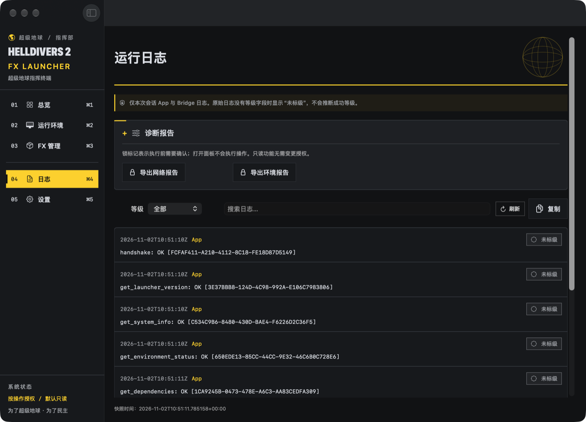
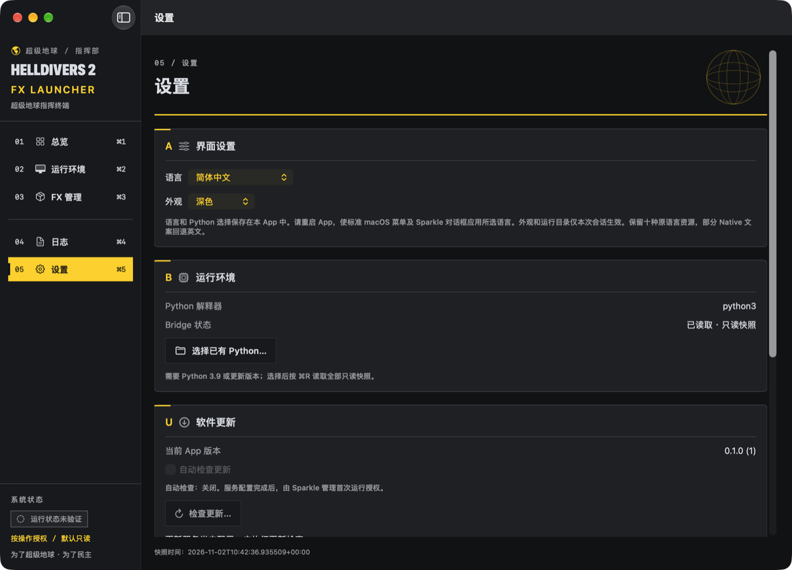

# HELLDIVERS 2 FX LAUNCHER

**macOS Native Launcher**

[**English**](#english) | [**简体中文**](#简体中文)


> [!IMPORTANT]
> **Developer preview · 开发预览** — No signed installer or complete game environment is provided. Game launch, EAC and multiplayer remain unverified.
> 尚无已签名安装包或完整游戏环境。游戏启动、EAC 和多人联机仍未完成实机验收。

[Native mainline / 主线](https://github.com/LSJOP/helldivers2-fx-launcher/tree/main) · [Development / 开发分支](https://github.com/LSJOP/helldivers2-fx-launcher/tree/feature/macos-native-app) · [Legacy Script / 原脚本](https://github.com/LSJOP/helldivers2-fx-launcher/tree/legacy-script) · [Migration checklist / 迁移清单](docs/FUNCTION_MIGRATION.md)

---

<a id="english"></a>

## English

[Overview](#en-overview) · [Features](#en-features) · [Screenshots](#en-screenshots) · [Requirements](#en-requirements) · [Installation](#en-installation) · [Usage](#en-usage) · [Development Status](#en-development) · [Legacy Script](#en-legacy) · [Disclaimer](#en-disclaimer) · [License](#en-license) · [简体中文](#简体中文)

<a id="en-overview"></a>

### Overview

A native macOS command interface for HELLDIVERS 2 FX Launcher, built with **SwiftUI + narrowly scoped AppKit**. A supervised **Python JSONL Bridge** reuses the original launcher Core while keeping system operations outside SwiftUI. The five-page military-tech interface defaults to dark, with light/system appearance available.

`main` is the Native App mainline; `feature/macos-native-app` contains current functional migration work and may be ahead of main. The descriptions below apply to that development branch. The archive is preserved separately.

<a id="en-features"></a>

### Features

| Status | Scope | What this means |
| --- | --- | --- |
|  | Native interface | Dashboard, Environment, FX Manager, Logs and Settings; Cmd+1…5 navigation and Cmd+R refresh; bundled Dashboard soldier illustration |
|  | Local inspection | Real host metadata, bounded FX discovery, versions and discovered paths; discovering an installation does not establish readiness |
|  | Configuration protection | Real read/edit/save, validation, revision conflicts, existing unknown-field preservation, backup and atomic replacement; checked with isolated data |
|  | Logs and diagnostics | Real progress/error streaming, bounded/redacted logs, search/filter/copy, user-reported match history and report export |
|  | Legacy operation integration | 20 Core interfaces, including launch, SSH/Guest/Steam checks, performance profile, network tests and profile/recovery; real backends are wired, live acceptance is pending |
|  | Localization and help | All ten original catalogs retained and selectable; new Native strings, full help/changelog presentation and broader reports remain partial |
|  | Distribution and integration | Signed/notarized distribution and CrossOver integration; no complete installer |
|  | Runtime and compatibility | FX/Guest/SSH/Steam behavior, actual game launch, fresh EAC evidence and multiplayer require separate live verification |

**Ten original locales:** zh-CN, en, ja, ko, ru, es, de, fr, pt-BR, zh-TW. Missing Native translations fall back to English.

An explicit official stable/preview release query is available; automatic installation is unavailable. The archived menu did not implement FX version switching, so it is not presented as a migrated capability.

<a id="en-screenshots"></a>

### Screenshots

**Dashboard — current hero integration, actual App capture on 2026-11-02.** Click for the full image.

[](docs/images/dashboard.png)

| Environment · 运行环境 | FX Manager · FX 管理 |
| :---: | :---: |
| [](docs/images/environment.png) | [](docs/images/fx-manager.png) |
| Logs · 运行日志 | Settings · 设置 |
| [](docs/images/logs.png) | [](docs/images/settings.png) |

> [!NOTE]
> All five images are real App-window captures, not generated UI mockups. Dashboard was captured after the hero integration (`def540c`). **The other four are historical captures from the earlier five-page UI review and are pending refresh**: their read-only labels and missing operation panels do not describe every current capability. They are retained as layout references. Images were proportionally reduced for the README; no status or UI was composited. No gameplay, EAC or multiplayer success is implied.

<a id="en-requirements"></a>

### Requirements

| Item | Requirement |
| --- | --- |
| Platform | Apple Silicon Mac, macOS 14 or newer |
| Local build | Complete Xcode with macOS SDK |
| Bridge | Existing Python 3.9 or newer interpreter |
| Legacy operations | Existing complete legacy launcher directory, originally verified FX/gvproxy assets and compatible SSH settings |

Runtime binaries, game files, fonts, credentials and Guest images are not bundled. The App does not install, relocate or silently select runtime assets. Arbitrary FX versions are not interchangeable with the original guarded runtime.

<a id="en-installation"></a>

### Installation

Build the current development preview:

```sh
git clone --branch feature/macos-native-app --recurse-submodules https://github.com/LSJOP/helldivers2-fx-launcher.git
cd helldivers2-fx-launcher/native-app
./script/build_and_run.sh --xcode-only
open build/Debug/HD2FXNative.app
```

For an existing clone, select the intended branch and run `git submodule update --init --recursive` from the repository root. Source ZIPs omit submodules. The pinned archive provides selected Core sources and locale catalogs; packaging does not run launch operations or download dependencies. There is no ready-to-install signed/notarized Native release.

<a id="en-usage"></a>

### Usage

1. Open the App and refresh local metadata. Refresh remains read-only.
2. In Settings, select language, appearance and an existing Python interpreter (default `/usr/bin/python3`). UI preferences and runtime-root selection are session-only.
3. Open the relevant action panel for detailed operations. Select the existing complete legacy directory when requested; verify the target and authentication settings.
4. Approve writes, SSH or launch explicitly. Specific Guest, performance and Wi-Fi changes require additional approval. Opening a page does not run a live operation.

<details>
<summary>Configuration, credentials and recovery paths</summary>

- Configuration: `~/Library/Application Support/Helldivers2FXLauncher/settings.json`. The editor shows the target/revision and backs up before replacement.
- Native diagnostics/reports: `~/Library/Application Support/Helldivers2FXLauncher/native`. Original Core recovery receipts may also be written under the selected legacy directory.
- Secrets travel through stdin, never command arguments; original SSH settings control Keychain use.
- Cancellation attempts supported recovery. Already started FX/Steam/game processes may continue; recheck actual state after interruption.

</details>

<a id="en-development"></a>

### Development Status

 

Native bundle version **0.1.0**, build **1**, comes from the [Xcode project](native-app/HD2FXNative.xcodeproj/project.pbxproj). Pinned Core version **0.1.0-preview.4** comes from [Core VERSION](https://github.com/LSJOP/helldivers2-fx-launcher/blob/f6dfb4c9757fe07c176d01e5e3f67cd404d87351/native-app-core-snapshot/VERSION). Neither number implies a published Release. The README instruction version is separate from software versions.

The last functional verification passed an Xcode Debug build, 18 protocol/metadata checks, 14 isolated migration checks, 21 service checks and one focused App smoke. Hero integration subsequently passed a build and a single App session checking two window sizes. These checks did not exercise a real game, live SSH or network/system changes. This README update only reuses that evidence.

See the [migration checklist](docs/FUNCTION_MIGRATION.md). Full Native translations and runtime acceptance remain incomplete. GitHub Actions is not published because the configured token lacks `workflow` permission; use the local development checks described in [AGENTS.md](AGENTS.md).

<a id="en-legacy"></a>

### Legacy Script

| Branch | Purpose |
| --- | --- |
| [main](https://github.com/LSJOP/helldivers2-fx-launcher/tree/main) | Native App mainline |
| [feature/macos-native-app](https://github.com/LSJOP/helldivers2-fx-launcher/tree/feature/macos-native-app) | Active Native development; not automatically merged |
| [legacy-script](https://github.com/LSJOP/helldivers2-fx-launcher/tree/legacy-script) | Original terminal launcher archive and pinned compatibility supplement |

[Original README](https://github.com/LSJOP/helldivers2-fx-launcher/blob/legacy-script/README.md) · [Script ZIP](https://github.com/LSJOP/helldivers2-fx-launcher/archive/refs/heads/legacy-script.zip) · [Original baseline 0205aca](https://github.com/LSJOP/helldivers2-fx-launcher/tree/0205acaec3b32024df180a6dfb8ecc587e2f1914)

Old main.zip links now download Native source; replace main with legacy-script in script-specific URLs. No archive content, Release or Tag is removed by this documentation work.

<a id="en-disclaimer"></a>

### Disclaimer


> [!WARNING]
> **A detected installation ≠ a usable runtime ≠ a launched game ≠ verified EAC ≠ working multiplayer.** Each requires its own fresh evidence. User-submitted match outcomes remain user reports.

This is an unofficial project with no claimed endorsement. No anti-cheat bypass or guaranteed compatibility is offered. The Dashboard image is a user-supplied generated illustration rendered inside the actual App; the software screenshots themselves are genuine captures.

<a id="en-license"></a>

### License

No project-wide source license has been selected. Do not assume blanket redistribution rights. HELLDIVERS 2 and related marks belong to their owners. See [rights and provenance](THIRD_PARTY_NOTICES.md) and archive notices.

[简体中文 ↓](#简体中文) · [Back to English](#english)

---

<a id="简体中文"></a>

## 简体中文

[项目介绍](#zh-overview) · [功能介绍](#zh-features) · [软件截图](#zh-screenshots) · [系统要求](#zh-requirements) · [安装方法](#zh-installation) · [使用说明](#zh-usage) · [开发进度](#zh-development) · [旧版脚本](#zh-legacy) · [免责声明](#zh-disclaimer) · [开源协议](#zh-license) · [English](#english)

<a id="zh-overview"></a>

### 项目介绍

面向 HELLDIVERS 2 FX Launcher 的 macOS 原生指挥界面，采用 **SwiftUI + 小范围 AppKit**。受监管的 **Python JSONL Bridge** 复用原启动器 Core，系统操作独立于 SwiftUI。五页军事科技界面默认深色，可选浅色或跟随系统。

`main` 是 Native App 主线；`feature/macos-native-app` 包含当前功能迁移，可能领先于 main。以下描述对应开发分支，原脚本另行归档保留。

<a id="zh-features"></a>

### 功能介绍

| 状态 | 范围 | 实际含义 |
| --- | --- | --- |
|  已实现 | 原生界面 | 总览、运行环境、FX 管理、日志、设置；Cmd+1…5 导航与 Cmd+R 刷新；首页士兵插图随 App 打包 |
|  已实现 | 本地检查 | 真实本机元数据、限定范围 FX 发现、版本和发现路径；检测到安装不等于运行就绪 |
|  已实现 | 配置保护 | 真实读取/编辑/保存，验证、修订冲突检查、已有未知字段保留、备份及原子替换；使用隔离数据验证 |
|  已实现 | 日志与诊断 | 真实进度/错误流、有容量限制且脱敏的日志、搜索/筛选/复制、用户报告的匹配历史和报告导出 |
|  开发中 | 原脚本操作集成 | 20 个 Core 接口，包含启动、SSH/Guest/Steam 检查、性能配置、网络测试及方案/恢复；已连接真实后端，仍待实机验收 |
|  开发中 | 多语言与帮助 | 保留并可选择原十种语言资源；新增 Native 文案、完整帮助/更新日志及更全面报告仍不完整 |
|  计划中 | 发行与集成 | 签名/公证发行、CrossOver 集成；没有完整安装包 |
|  未验证 | 运行环境与兼容性 | FX/Guest/SSH/Steam 行为、真实游戏启动、新鲜 EAC 证据和多人联机需要分别实机验证 |

**原十种语言：** zh-CN、en、ja、ko、ru、es、de、fr、pt-BR、zh-TW。缺失的 Native 翻译回退英文。

可主动查询官方 stable/preview 版本，不支持自动安装。归档菜单没有实现 FX 版本切换，因此不将其作为已迁移能力展示。

<a id="zh-screenshots"></a>

### 软件截图

**总览——2026-11-02 士兵素材集成后的真实 App 截图。** 点击可查看大图。

[](docs/images/dashboard.png)

| Environment · 运行环境 | FX Manager · FX 管理 |
| :---: | :---: |
| [](docs/images/environment.png) | [](docs/images/fx-manager.png) |
| Logs · 运行日志 | Settings · 设置 |
| [](docs/images/logs.png) | [](docs/images/settings.png) |

> [!NOTE]
> 五张均为真实 App 窗口截图，不是生成式 UI 预览图。总览采集于士兵素材集成后（`def540c`）。**其余四张来自较早的五页 UI 检查，属于待更新的历史截图**：其中只读标签及缺少操作面板的状态，不代表当前全部功能，仅保留作布局参考。图片仅按比例缩小用于 README，没有合成界面或运行状态，不证明游戏、EAC 或联机成功。

<a id="zh-requirements"></a>

### 系统要求

| 项目 | 要求 |
| --- | --- |
| 平台 | Apple Silicon Mac，macOS 14 或更新版本 |
| 本地构建 | 包含 macOS SDK 的完整 Xcode |
| Bridge | 已有 Python 3.9 或更新解释器 |
| 原运行环境操作 | 已有完整旧启动器目录、原验证版本 FX/gvproxy 资源和兼容 SSH 配置 |

不捆绑运行时二进制、游戏文件、字体、凭据或 Guest 镜像。App 不安装、移动或静默选用运行资源。任意 FX 版本不能替代原有受保护的运行环境。

<a id="zh-installation"></a>

### 安装方法

构建当前开发预览版：

```sh
git clone --branch feature/macos-native-app --recurse-submodules https://github.com/LSJOP/helldivers2-fx-launcher.git
cd helldivers2-fx-launcher/native-app
./script/build_and_run.sh --xcode-only
open build/Debug/HD2FXNative.app
```

已有克隆请先切换目标分支，再于仓库根目录执行 `git submodule update --init --recursive`。源码 ZIP 不含子模块。固定归档提供选定 Core 源码和语言资源；打包不执行启动操作或下载依赖。暂无已签名/公证、可直接安装的 Native 发行版。

<a id="zh-usage"></a>

### 使用说明

1. 打开 App，刷新本地元数据。刷新保持只读。
2. 设置页选择语言、外观及已有 Python 解释器（默认 `/usr/bin/python3`）。界面偏好和运行根目录选择仅在本次会话生效。
3. 在对应面板主动执行详细操作，需要时选择已有完整旧目录，核对目标与认证设置。
4. 写入、SSH 和启动均需明确授权；具体 Guest、性能及 Wi-Fi 变更还需额外确认。仅打开页面不会执行实机操作。

<details>
<summary>配置、凭据与恢复路径</summary>

- 配置：`~/Library/Application Support/Helldivers2FXLauncher/settings.json`。编辑器显示目标/修订，替换前备份。
- Native 诊断/报告：`~/Library/Application Support/Helldivers2FXLauncher/native`。原 Core 恢复凭据还可能写入选定旧目录。
- 秘密通过 stdin 传递，不进入命令参数；钥匙串使用由原 SSH 配置控制。
- 取消会尝试支持的恢复。已经启动的 FX/Steam/游戏进程可能继续运行，中断后请重新核对实际状态。

</details>

<a id="zh-development"></a>

### 开发进度

 

Native 包版本 **0.1.0**、构建号 **1** 来自 [Xcode 工程](native-app/HD2FXNative.xcodeproj/project.pbxproj)；固定 Core 版本 **0.1.0-preview.4** 来自 [Core VERSION](https://github.com/LSJOP/helldivers2-fx-launcher/blob/f6dfb4c9757fe07c176d01e5e3f67cd404d87351/native-app-core-snapshot/VERSION)。两者均不代表已经发布 Release，README 指令版本与软件版本独立。

最近一次功能验证通过 Xcode Debug 编译、18 项协议/元数据检查、14 项隔离迁移检查、21 项服务检查和一次针对性 App 冒烟验证。随后士兵素材集成通过编译，并在一次 App 会话中检查两种窗口尺寸。这些检查没有执行真实游戏、实机 SSH 或网络/系统变更。本次 README 修改仅复用上述证据。

各项状态见[迁移清单](docs/FUNCTION_MIGRATION.md)。完整 Native 翻译与实机验收仍未完成。当前 token 缺少 `workflow` 权限，尚未发布 GitHub Actions 配置；本地开发检查规则见 [AGENTS.md](AGENTS.md)。

<a id="zh-legacy"></a>

### 旧版脚本

| 分支 | 用途 |
| --- | --- |
| [main](https://github.com/LSJOP/helldivers2-fx-launcher/tree/main) | Native App 主线 |
| [feature/macos-native-app](https://github.com/LSJOP/helldivers2-fx-launcher/tree/feature/macos-native-app) | 当前 Native 开发，不自动合并 |
| [legacy-script](https://github.com/LSJOP/helldivers2-fx-launcher/tree/legacy-script) | 原终端启动器归档及固定兼容补充 |

[原版 README](https://github.com/LSJOP/helldivers2-fx-launcher/blob/legacy-script/README.md) · [脚本 ZIP](https://github.com/LSJOP/helldivers2-fx-launcher/archive/refs/heads/legacy-script.zip) · [原始基线 0205aca](https://github.com/LSJOP/helldivers2-fx-launcher/tree/0205acaec3b32024df180a6dfb8ecc587e2f1914)

旧 main.zip 链接现在下载 Native 源码；脚本专属链接请将 main 改为 legacy-script。本次文档修改不删除归档内容、Release 或 Tag。

<a id="zh-disclaimer"></a>

### 免责声明


> [!WARNING]
> **检测到安装 ≠ 运行环境可用 ≠ 游戏启动成功 ≠ EAC 验证成功 ≠ 多人联机成功。** 每项都需要独立的新鲜证据，用户录入的匹配结果仍属于用户报告。

本项目非官方，不宣称获得官方认可，不提供反作弊绕过或兼容性保证。首页插图为用户提供的生成式素材，在真实 App 中渲染；软件截图本身均为实际窗口采集。

<a id="zh-license"></a>

### 开源协议

尚未选定项目统一源码许可证，不应推定均可自由再分发。HELLDIVERS 2 及相关标识归各权利人所有。见[权利与来源说明](THIRD_PARTY_NOTICES.md)及归档声明。

[English ↑](#english) · [返回中文](#简体中文)
