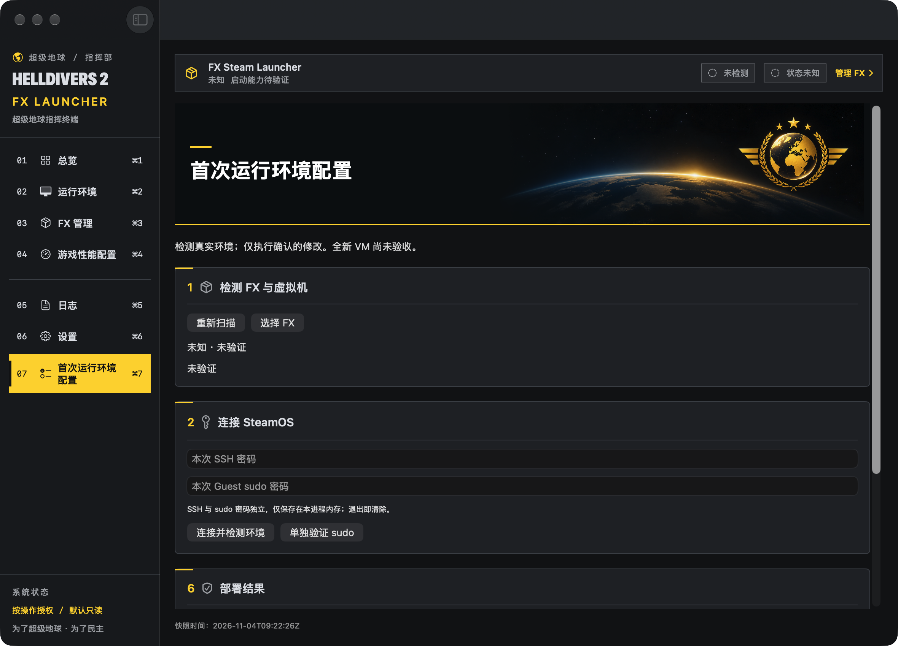

<div align="center">
  
  <h1>HELLDIVERS 2 FX Launcher</h1>
  <p>为 Apple Silicon Mac 打造的 HELLDIVERS 2 FX 启动与管理工具。</p>
</div>

<a id="简体中文"></a>

[**English**](README.md) | [**简体中文**](README.zh-CN.md)


[软件截图](#zh-screenshots) · [主要功能](#zh-features) · [下载安装](#zh-installation) · [快速开始](#zh-usage) · [兼容性](#zh-development) · [更新日志](#zh-changelog) · [原脚本](#zh-legacy)


### 首次运行环境配置（独立开发版）

打开**首次运行环境配置**，选择 FX，分别输入仅供本进程使用的 SSH／sudo 密码，然后连接并检测。审阅目标身份、配置档和具体修改后点击**配置运行环境**。离线写入配置前请自行退出 Steam 和游戏；再次检测会跳过已正确配置的应用管理项。恢复功能仅使用本应用收据，核对当前值，遇到目标变化或外部修改就停止。

候选矩阵为 FX **1.9.8**／SteamOS **0.4.5**／**aarch64**／AppID **553850**。这是历史目标，不代表所有同版本安装都含有相同组件。FEX／Proton-JE 的公开部署在取得审核发行包、完整清单、哈希、构建来源及许可证前为 **BLOCKED**。不分发私人 VM 文件。初始配置档不强制代理、gvproxy 替换、IPv4-only、CPU 亲和性或历史 CPU／内存／GPU 预算。硬件／FX 建议沿用现有受保护的性能页面。

组件来源、恢复规则、常见错误与测试边界见[实现报告](NATIVE_FIRST_RUN_DEPLOYMENT_IMPLEMENTATION.md)、[配置档矩阵](NATIVE_ENVIRONMENT_PROFILE_MATRIX.md)、[安全审查](NATIVE_DEPLOYMENT_SECURITY_REVIEW.md)、[测试结果](NATIVE_DEPLOYMENT_TEST_RESULTS.md)和[验收报告](NATIVE_FIRST_RUN_ACCEPTANCE.md)。缺失或不支持的版本需要新的审核配置档；`ARTIFACT_UNAPPROVED` 表示未尝试安装，`STEAM_RUNNING` 需要退出 Steam 后重新检测，`RECOVERY_REQUIRED` 会阻止后续部署，直到解决收据所记录的修改。配置写入成功不等于游戏、EAC 或多人验证通过。全新 VM 验收为 **NOT_TESTED**，Latest 未修改。


<a id="zh-overview"></a>

以 **SwiftUI + AppKit** 构建、**Swift 原生核心**驱动：启动游戏、检查所选 FX 环境、管理性能配置。七个页面职责清晰，默认深色，操作进度和结果在页面内显示，技术细节按需展开。正式运行不使用 Python 解释器、Python Bridge 或外部脚本目录。

> [!IMPORTANT]
> **开发预览。** 正式安装包尚未发布。已完成的 Native 成果已整合到 [main](https://github.com/LSJOP/helldivers2-fx-launcher/tree/main)；[feature/macos-native-app](https://github.com/LSJOP/helldivers2-fx-launcher/tree/feature/macos-native-app) 保留开发历史。仓库不包含运行时二进制、游戏文件或 Guest 镜像。

<a id="zh-screenshots"></a>

总览、设置与首次配置为 2026-11-04 独立 Debug build 2026110410 的真实窗口；其他页面保留历史截图。截图未修改像素，不代表 Guest／游戏验收。

## 软件截图

**Native 接管预览：** Guest SSH 已修正 OpenSSH 参数并使用控制终端，运行环境新增只读的“测试 Guest SSH 连接”。仅在 App 安全输入框中输入凭据。设置 → 关于显示并可复制随包构建身份。真实 Guest 密码认证与游戏仍需用户验收；隔离测试不代表真实验收。运行环境与设置截图已于 2026-11-04 使用真实 Debug App 更新；屏幕外的关于信息另做 Release 验收。其他截图保留为历史预览。 SSH 专项检查在验证发布者签名与父子关系后，可检查已运行的 FX 自带网络进程；游戏启动仍要求固定的内置后端。

截图拍摄于 Swift 原生核心改版之前，仅作布局参考；`docs/images/manifest.json` 已标记为**待重新拍摄**，当前标签和状态文字可能不同。

[](docs/images/zh-CN/dashboard.png)

| 运行环境 | FX 管理 |
| --- | --- |
| [](docs/images/zh-CN/environment.png) | [](docs/images/zh-CN/fx-manager.png) |

<details>
<summary>游戏性能配置</summary>

[](docs/images/zh-CN/performance.png)

[](docs/images/zh-CN/performance-actions.png)

</details>
<details>
<summary>日志、设置与软件更新</summary>

[](docs/images/zh-CN/logs.png)
[](docs/images/zh-CN/settings.png)
[](docs/images/zh-CN/settings-updates.png)

</details>


简体中文真实 Debug App 窗口：总览、设置与首次配置于 2026-11-04 更新（构建 2026110410）；其余页面明确保留历史截图。原始像素未改动，采集副本隔离偏好，仅检查本机只读状态，未连接 Guest。截图不代表安装／游戏验收。[采集来源与限制](docs/images/README.md)。

<a id="zh-features"></a>

性能编辑现支持已固定构建的 **FX 1.9.4**：CPU、Guest 内存、实际可用的 Vulkan 驱动、Metal HUD。流程为读取 → 编辑 → 预览确认 → 自动备份并验证 → 写入并重新读取；恢复使用本系统的真实备份，外部修改会阻止覆盖。FX 运行时禁止写入，不会自动停止或重启。保存后需重新启动 FX／Guest，仍显示运行中配置未验证。原启动命令会覆盖参数，固定预检可能拒绝自定义值，使用原路径前应恢复备份。超分辨率与 6144 MiB GPU 预算保持只读，无性能提升保证。对应语言的当前截图已同步。[机制、范围与风险](docs/GAME_PERFORMANCE.md)。

## 主要功能

| 状态 | 功能 |
| --- | --- |
| 🟢 已实现 | 七页原生界面、Cmd+1…7 导航、深色／浅色／跟随系统、正式项目图标 |
| 🟢 已实现 | 限定范围本机／FX 发现；带校验、修订检查、备份和原子替换的配置编辑 |
| 🟢 已实现 | 可搜索、筛选、有容量限制且脱敏的日志与诊断报告 |
| 🟢 已实现 · 受保护写入 | 硬件／FX 偏好与参考对比；固定 FX 1.9.4 构建的限定参数编辑、备份与恢复 |
| 🟠 开发中 | 一键检测与 SSH 后台操作；原入口 FX／Steam 启动、SSH／sudo 独立凭据复用；新入口实机验收仍待完成 |
| 🟢 已实现 · 静态覆盖检查通过 | 原 Python 十语言资源单独保留；Native 统一资源覆盖全部十语言。缺失文案明确显示缺失键，不回退英文；译文自然度仍需人工审校 |
| ⚪ 计划中／不可用 | 安全停止／重启 FX、经过验证的性能推荐、签名／公证安装包 |

性能规则完全本地、可复现。原记录中的 **M4 Pro／24 GiB** 配置仅是候选基准，不代表全面性能验收。其他硬件不生成可写推算配置；限定参数支持预览确认、备份写入与冲突保护恢复；原启动参数覆盖及其他限制见下文。见[参数来源与限制](docs/GAME_PERFORMANCE.md)。

<a id="zh-requirements"></a>
<a id="zh-installation"></a>

## 下载与安装

**正式安装包尚未发布。** 仓库 [Releases 页面](https://github.com/LSJOP/helldivers2-fx-launcher/releases) 当前没有已发布版本；此链接不是不存在的安装包下载按钮。

源码预览需要 **Apple Silicon、macOS 14+、完整 Xcode／macOS SDK**。游戏操作需要已安装且由发行方签名的 FX Steam Launcher，以及可通过 SSH 连接的 FX Guest。启动所需的 gvproxy 资源已内置并通过 SHA-256 校验。

```sh
git clone --branch main --recurse-submodules https://github.com/LSJOP/helldivers2-fx-launcher.git
cd helldivers2-fx-launcher/native-app
./script/build_and_run.sh --xcode-only
open build/Debug/HD2FXNative.app
```

已有克隆需核对目标分支，并执行 `git submodule update --init --recursive`。源码 ZIP 不包含固定 Core 子模块。见[开发指南](docs/NATIVE_DEVELOPMENT.md)。

<a id="zh-usage"></a>

## 快速开始

1. 打开 App，在设置中选择语言与外观，然后在 FX 管理中选用已安装的 FX Steam Launcher。
2. 首次操作选择已有启动器目录。“一键检测”只读检查 Guest，要求 FX 已运行；需要时先在 FX 管理中点击“启动 FX”。
3. 在总览点击“启动 HELLDIVERS 2”，原有启动流程自动完成必要检查。核对启动确认及具体配置变更预览；密码仅填写 App 安全输入框。
4. 在游戏性能配置页查看硬件与基准差异，在日志页查看错误详情。检测到进程不代表已经进入主菜单。

<a id="zh-development"></a>

## 兼容性状态

| 证据 | 当前结果 |
| --- | --- |
| Native App | Debug 构建、六页冒烟检查通过；本轮定向检查为 35 项迁移及 9 项推算用例 |
| FX／游戏进程 | 此前记录中的专用 FX 1.9.4 启动已观察到；不代表任意 FX 安装均兼容 |
| 主菜单／可操作飞船 | 2026-11-03 用户明确确认，限定于该记录环境 |
| 当前 GUI SSH／Guest 读取 | 已连接真实后端；最近宿主检查因另一份 FX 正在运行，在连接前拒绝。新入口的成功实测仍待完成 |
| 单人任务／独立 EAC 验收／多人联机 | 分别保持**未验证** |
| 性能 | 受保护的偏好编辑与备份恢复，没有实测性能保证，也不自动调优 |

> [!WARNING]
> 发现安装 ≠ 运行就绪 ≠ 游戏进程已启动 ≠ 进入主菜单 ≠ EAC 验证成功 ≠ 多人联机成功。不提供反作弊绕过。

<a id="zh-changelog"></a>

## 更新日志

尚未发布任何正式版本；当前原生版本 `0.1.0` 为开发预览。近期未发布改动：

- 原生七页界面、限定范围 FX 发现、带校验的配置编辑、脱敏日志与只读性能比较。
- GUI 化 FX／SSH 操作与可选 SSH／sudo 凭据记忆。
- Sparkle 2 更新集成（Feed／签名服务尚未配置）。

完整历史见 [CHANGELOG.zh-CN.md](CHANGELOG.zh-CN.md)。

## 常见问题

- **为什么停止／重启或部分应用按钮禁用？** 正常退出后端尚未验证。性能编辑只支持固定 FX 1.9.4 构建，需读取合法配置、FX 停止并预览确认；无有效备份或外部修改会阻止恢复。App 不强制停止 FX。
- **每次都要输入密码吗？** SSH 与 sudo 分别保留在本进程内存，可在本次 App 会话内复用。不使用 Keychain 或密码文件；目标／修订变化及退出 App 后清除。旧脚本／App 保存的钥匙串项目不访问、不删除。
- **自动更新能用了吗？** 在「设置 → 软件更新」可手动检查 GitHub Native 发布。默认稳定版；正式服务未就绪前，预览渠道及自动检查保持关闭。安全下载需要可信 Ed25519 公钥与签名清单；缺少签名 Appcast、Developer ID、公证及分发条件时禁止安装。手动检查不会自动安装；自动检查开关需签名服务就绪才可启用。下载校验包含签名、大小与 SHA-256，安装仅由官方 Sparkle 执行。目前尚无正式更新包，失败保留当前 App，不把下载成功视为安装或重启成功。发布准备复用历史更新源前会先验证其签名。[配置和发布条件](docs/NATIVE_UPDATES.md)。

<a id="zh-legacy"></a>

## 开发文档与原脚本

- [main](https://github.com/LSJOP/helldivers2-fx-launcher/tree/main)：已整合 Native 成果的主线。
- [feature/macos-native-app](https://github.com/LSJOP/helldivers2-fx-launcher/tree/feature/macos-native-app)：保留 Native 开发历史，后续复用前需安全同步 main。
- [legacy-script](https://github.com/LSJOP/helldivers2-fx-launcher/tree/legacy-script)：原脚本归档，保留历史。
- [开发指南](docs/NATIVE_DEVELOPMENT.md) · [迁移证据](docs/FUNCTION_MIGRATION.md) · [性能配置](docs/GAME_PERFORMANCE.md) · [自动更新](docs/NATIVE_UPDATES.md) · [开发规则](AGENTS.md)

<a id="zh-disclaimer"></a>
<a id="zh-license"></a>

## 免责声明与协议

本项目非官方，不宣称获得官方认可，不保证兼容性。HELLDIVERS 2 及相关标识归各权利人所有。项目统一源码许可证**尚未选定**，不应推定均可自由再分发。见[权利与来源说明](THIRD_PARTY_NOTICES.md)，其中保留 Sparkle 的独立许可证和用户提供素材的来源。

开发检查：`native-app/script/run_checks.sh` 编译并运行原生核心契约检查、十语言门槛与文档检查。Python 仅用于可选开发脚本；App Bundle 与正式运行流程不含 Python。界面变更必须审查中英文 README 及真实截图。中英文截图均针对整合后的界面更新；译文自然度仍需人工审校。发布检查 Actions 模板保持未启用，尚未配置 CI 工作流。

FX 选择 V2 + 自动选择 V2.1：FX 管理、总览和启动窗口共享并持久化同一个默认 FX。扫描结果中只有一个通过身份和路径验证的 FX 时自动选择；多个 FX 时保留有效默认，否则请用户选择。默认 FX 删除、移动或更新后重新验证。选择后仍显示**启动能力待验证**，不会自动启动游戏。每次启动先重扫默认 FX，并为检查、预检和执行固定同一份所选路径。完整性校验接受历史精确哈希，或通过 Apple 信任锚、Bundle ID 与 Team ID 校验的 FX 发布者完整签名；再次核对已验证摘要，并保留全部原有配置、进程和 Guest 检查。这不代表游戏兼容性已经验证。FX 应用和辅助脚本／gvproxy 的启动资源目录明确区分：优先从所选应用的有限上级目录或已有资源目录解析，无法解析时才请用户定位一次**启动资源**，不再重复选择 FX 目录。刷新与自动检查不会启动 FX、SSH 或游戏。停止／重启仍不可用。限定参数的性能编辑与备份恢复要求固定版本 FX 1.9.4 已停止，并需明确预览和确认；推算推荐仍只读。

启动资源：`/Applications` 和 FX `.app` 不是原始脚本资源目录。请选择包含 `launcher-20261026/steam-cdp.mjs`、`tools/check_node.cjs` 和 `goal-fx-multiplayer-20261026/gvproxy-eim-wrapper` 的完整现有脚本目录。检查与执行共用内置归档对比，提供预期／实际完整路径与 SHA-256 诊断。资源缺失、改动或符号链接均拒绝执行，不修改 FX 文件。FX 1.9.4／1.9.8 的路径和签名检查已有覆盖，真实游戏仍未验证。

sudo 排查（2026-11-04）：构建 2026110402 存在远程空提示符参数引用缺陷。相关修复及 sudo/SSH 错误分类正在验证，尚未发布替代构建。真实只读检查已通过完整 Guest 身份确认；带密码 sudo 及后续启动阶段仍未验证。

首次配置（独立 Debug 真实窗口）：


