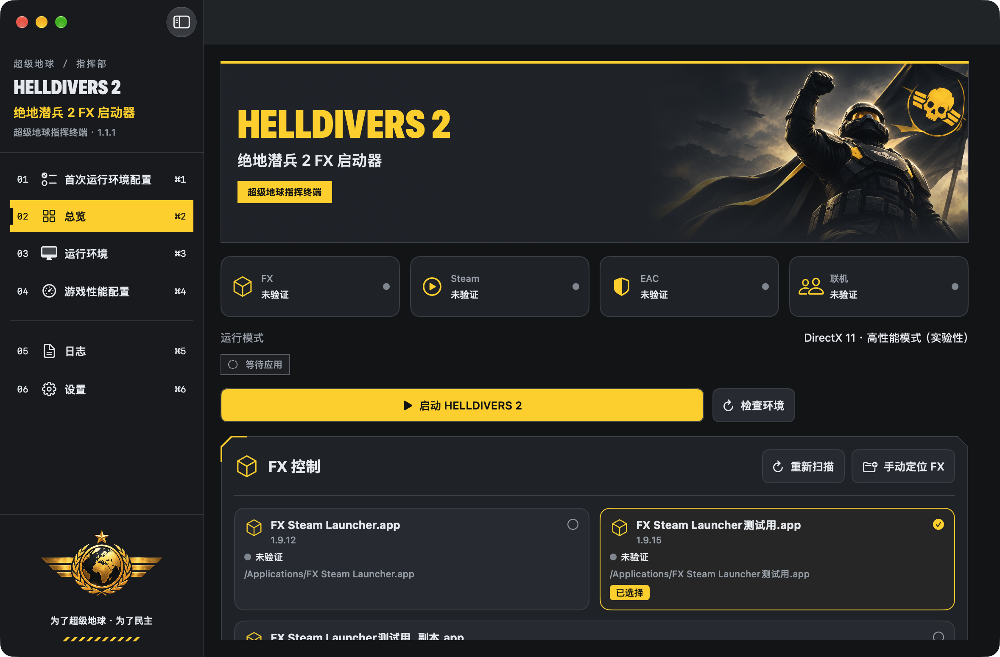
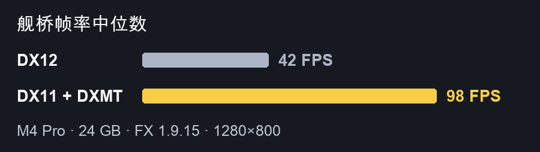
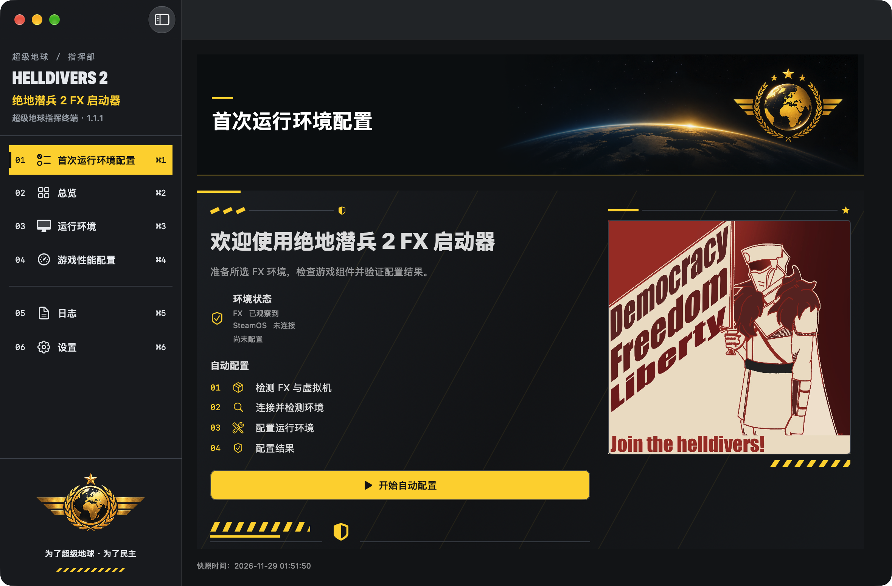
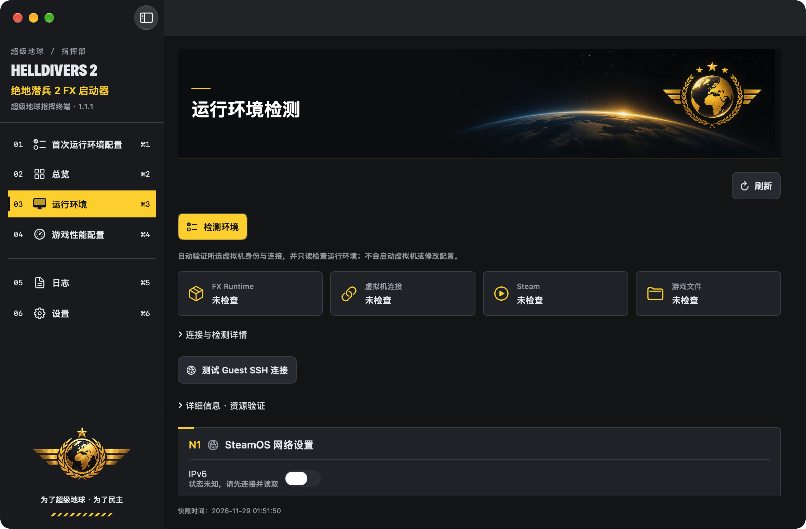
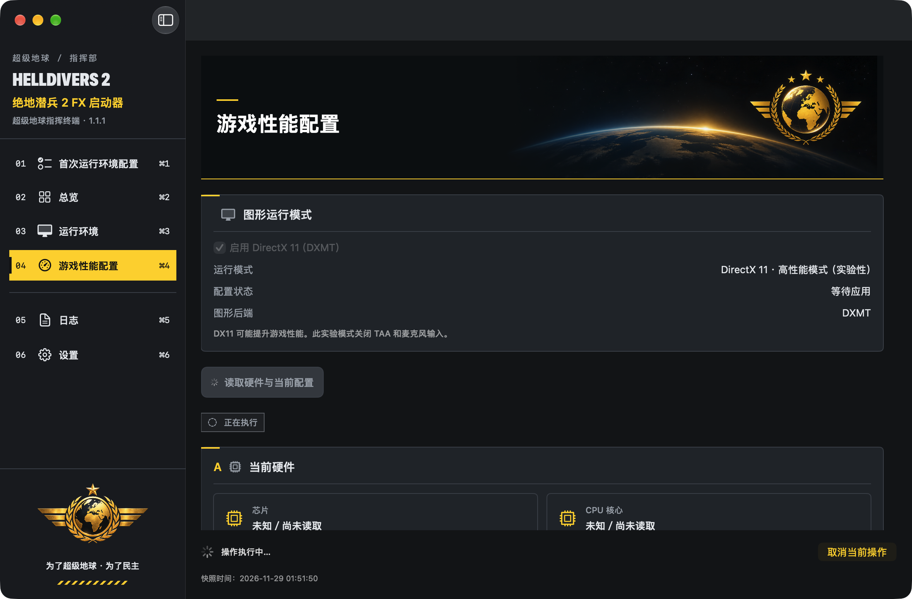
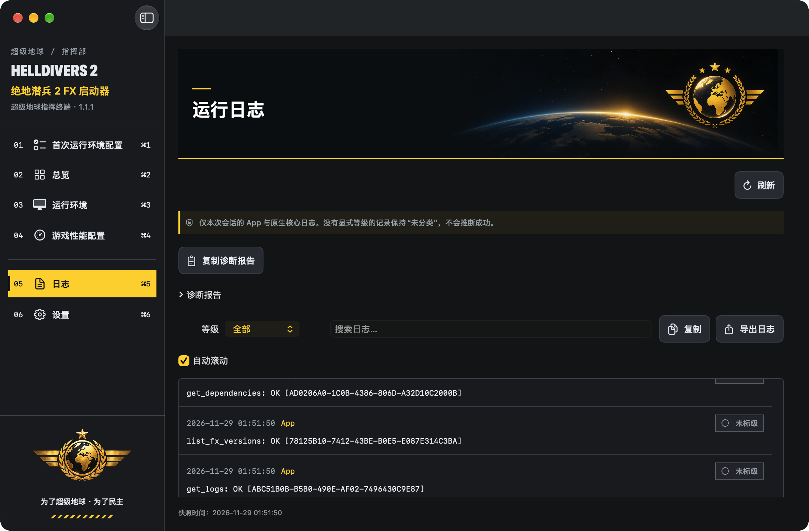
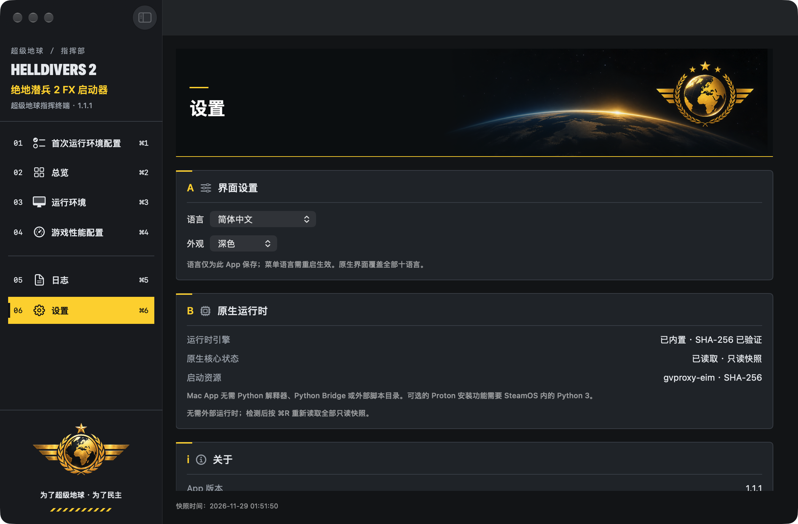

<h1 align="center">HELLDIVERS 2 FX Launcher</h1>

Apple Silicon · macOS 14+ · arm64

<a href="#简体中文">简体中文</a> | <a href="README.md#english">English</a>

<!-- stable-version:start -->

Stable Release · v1.1.1

<!-- stable-version:end -->

<!-- stable-download:start -->

<!-- stable-download:end -->

<a href="https://github.com/LSJOP/helldivers2-fx-launcher/releases">历史版本</a> | <a href="CHANGELOG.zh-CN.md">更新日志</a>

## 简体中文

面向 Apple Silicon Mac 的第三方社区启动器，通过 FX Steam Launcher 启动和管理《绝地潜兵 2》。

### 软件总览

### 最新版本亮点

- 在设置中统一输入 SteamOS 密码，认证失败时可在该处处理。保存的密码经过加密，限定在所选 FX 实例、磁盘和连接范围内。
- FX 和 SteamOS 会话保持一致时，启动可复用健康连接和已有环境检测结果。
- Steam 就绪后检查 DX11 兼容性。切换模式时沿用最新游戏设置，切回 DX12 时恢复启动参数、TAA 和音频设置。
- 从日志复制脱敏报告，可分享配置、认证、图形和音频信息。

### 核心功能

- **一键启动**。完成配置后，从总览启动《绝地潜兵 2》。
- **首次运行引导**。检查环境，经你同意后自动配置必要组件。
- **FX 管理**。识别本机已安装的 FX，选择并打开要使用的实例。
- **环境检测与修复**。定位缺失或损坏的组件，并修复受支持的配置。
- **图形与性能设置**。在 DX12 和实验性 DX11 之间切换，调整 Apple Silicon 游戏性能配置。
- **SteamOS 密码管理**。密码集中在设置中输入。
- **软件更新、10 种界面语言、日志与诊断**。在「设置 → 软件更新」中检查更新。

### DX11 与 DX12 性能

在这次短时舰桥测试中，DX11 + DXMT 的帧率中位数约为 DX12 的 **2.33 倍**。测试环境为 M4 Pro、24 GB 统一内存、FX 1.9.15、1280×800。两组的音频配置和宿主内存压力不同。结果仅适用于这台 Mac 和这个测试场景。实际任务、多人联机及双向语音在此配置下尚未验证。[测试报告和证据索引](docs/environment/HD2_SUCCESSFUL_ENVIRONMENT_BASELINE.md#验收索引和限界)

### 软件截图

| 配置与诊断 | 启动器控制 |
| --- | --- |
| 首次运行环境配置 | 运行环境 |
|  |  |
| 游戏性能配置 | 日志 |
|  |  |
| 设置 | |
|  | |

### 系统要求与兼容性

- Apple Silicon Mac（arm64），macOS 14 或更高版本。
- 推荐 [FX Steam Launcher 1.9.15]。FX 内须安装 Steam 和正版《绝地潜兵 2》。

| 功能 | 状态 |
| --- | --- |
| DX12（默认） | v1.1.1 较早候选版在 FX 1.9.15 上已实测进入舰桥 |
| DX11 + DXMT | 实验性。较早候选版在 FX 1.9.15 上已实测进入舰桥，音频仅播放 |
| 实际任务、公开联机、实体麦克风及双向语音 | 本次发布及配置下尚未验证 |
| 全新安装、App 内升级及重启、更新失败恢复 | 正式发布获准跳过验收，尚未验证 |
| Intel Mac 和低于 macOS 14 的系统 | 不支持 |

### 快速安装与使用

1. 安装 [FX Steam Launcher 1.9.15]。
2. 在 FX 中安装《绝地潜兵 2》。
3. 点击上方 DMG 按钮，打开磁盘映像，将启动器拖入「应用程序」。
4. 打开启动器，在「设置」中填写 SteamOS 密码。
5. 点击「启动 HELLDIVERS 2」。如有首次配置提示，先确认拟执行的操作。

#### 安装安全

运行 `shasum -a 256 <下载的 DMG>`，与 [SHA256SUMS.txt](https://github.com/LSJOP/helldivers2-fx-launcher/releases/latest/download/SHA256SUMS.txt) 比对。App 采用 ad hoc 签名，未经过 Apple 公证。如果 Gatekeeper 阻止打开已校验的 App，请使用「系统设置 → 隐私与安全性 → 仍要打开」。

### 常见问题与已知限制

- **为什么 DX11 需要确认？** DXMT 可能扩大受信任 SteamOS 虚拟机对 Mac 的访问范围。首次启用时，请阅读提示并在信任所选虚拟机时确认。当前 DX11 会关闭 TAA 和麦克风输入。游戏可能显示驱动版本提示。
- **如何切回 DX12？** 退出游戏，在「游戏性能配置」关闭 DX11 或选择「恢复 DX12」。
- **游戏进不了舰桥怎么办？** 记录卡住的位置和声音是否继续。条件允许时检查 DX12 能否进入舰桥，再从日志复制脱敏诊断报告。[已知问题](docs/acceptance/KNOWN_ISSUES.md)

### 更新日志

<!-- stable-build:start -->
构建 `2026112906` · [发布提交 `7a0e2b1`](https://github.com/LSJOP/helldivers2-fx-launcher/commit/7a0e2b16e09a66f6f3c6573f5fd21105a62eb671)
<!-- stable-build:end -->

[正式发布说明](https://github.com/LSJOP/helldivers2-fx-launcher/releases/latest) · [完整更新日志](CHANGELOG.zh-CN.md)

### 用户反馈

可报告启动、配置、更新或界面问题，也可提出功能建议。请提供 Mac 型号、macOS 和 FX 版本，以及适用的脱敏诊断报告。[选择反馈模板](https://github.com/LSJOP/helldivers2-fx-launcher/issues/new/choose)

### 作者与鸣谢

由 [LSJOP](https://github.com/LSJOP) 维护。首次运行和启动插画由 **MOTR7** 创作，经授权使用。感谢 FX 和第三方声明中列出的上游兼容项目。

### 第三方许可及免责声明

本项目是独立社区项目，与《绝地潜兵 2》制作方没有隶属关系。游戏名称和商标归各自权利人所有。[第三方许可、源代码与插画声明](THIRD_PARTY_NOTICES.md)

### 开发者文档

[文档索引](docs/README.md) · [开发指南](docs/NATIVE_DEVELOPMENT.md) · [历史截图归档](docs/images/README.md)

[FX Steam Launcher 1.9.15]: https://github.com/fxgl/steamac/releases/tag/v1.9.15
