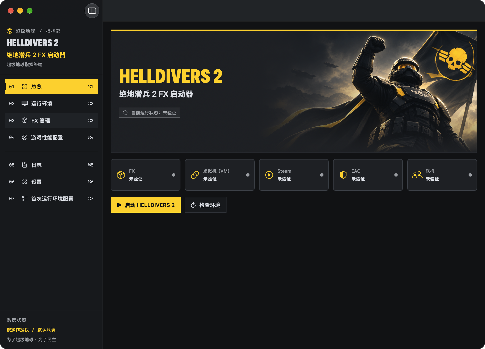
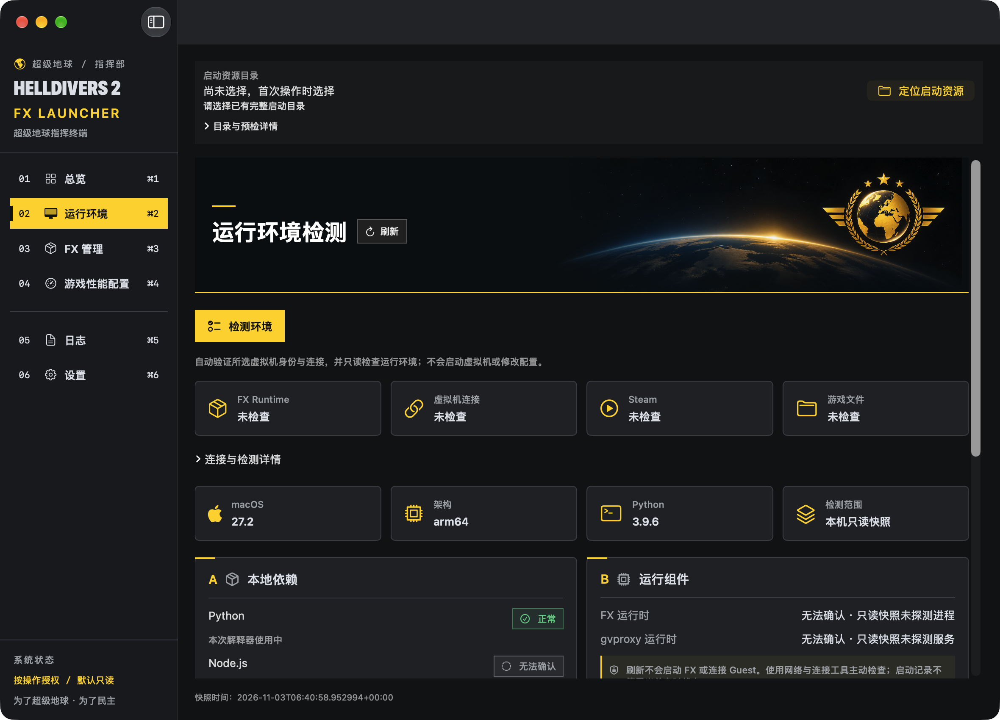
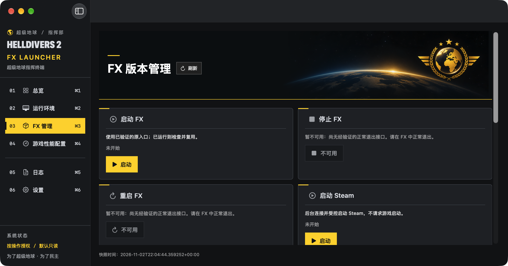
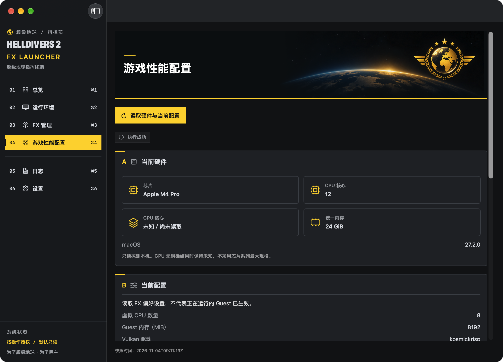
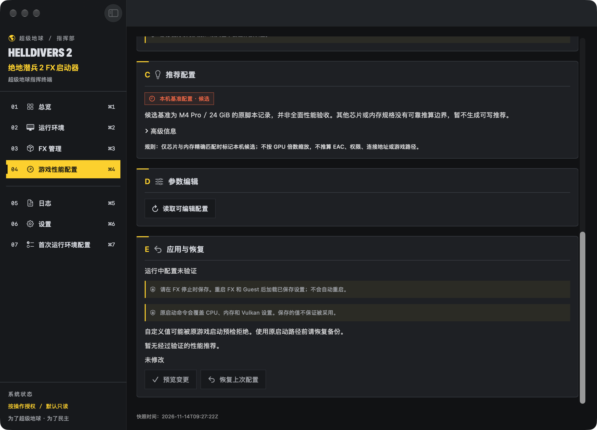
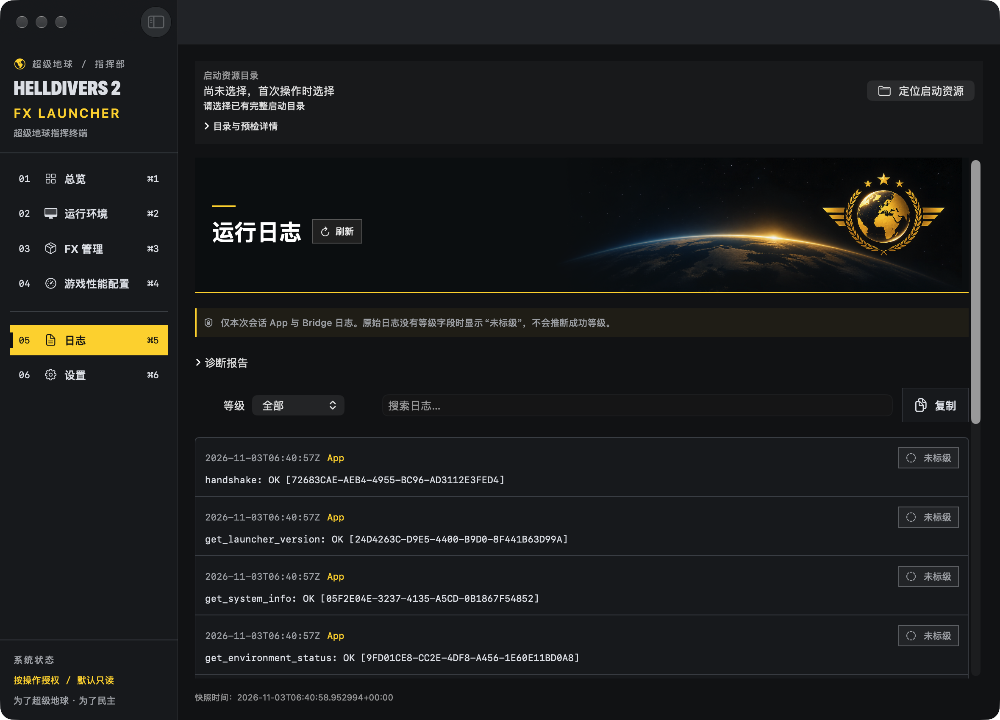
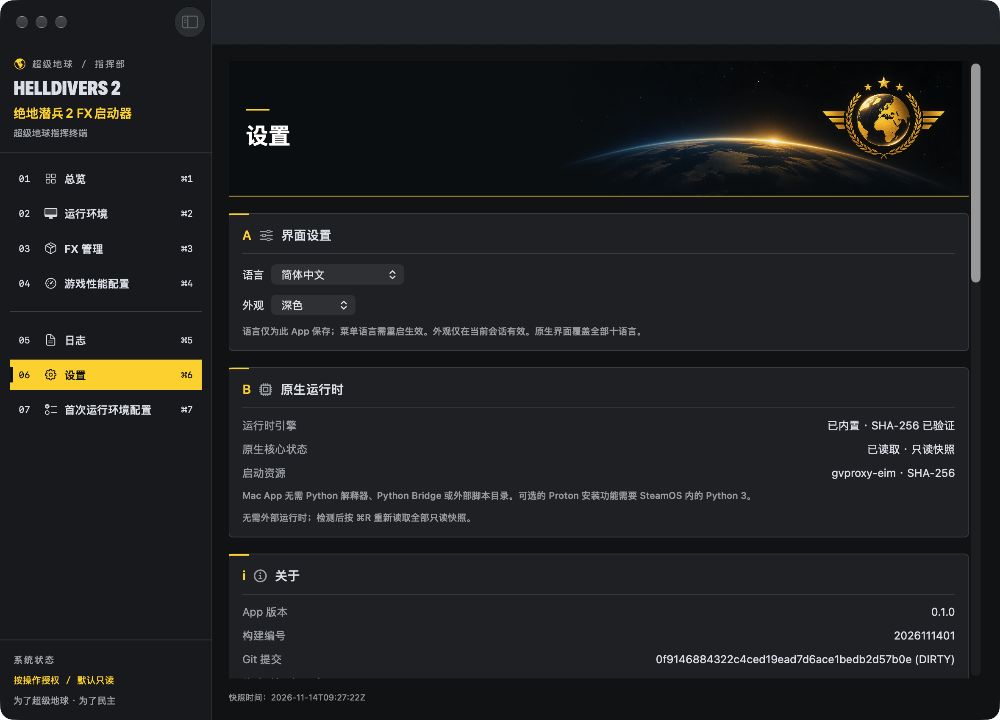
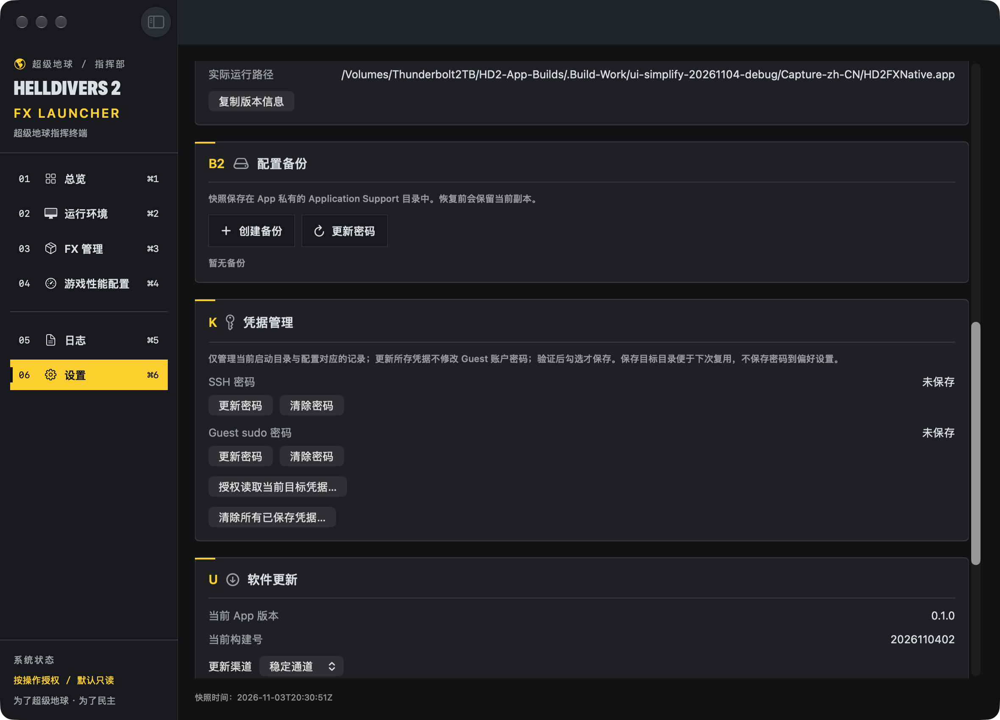
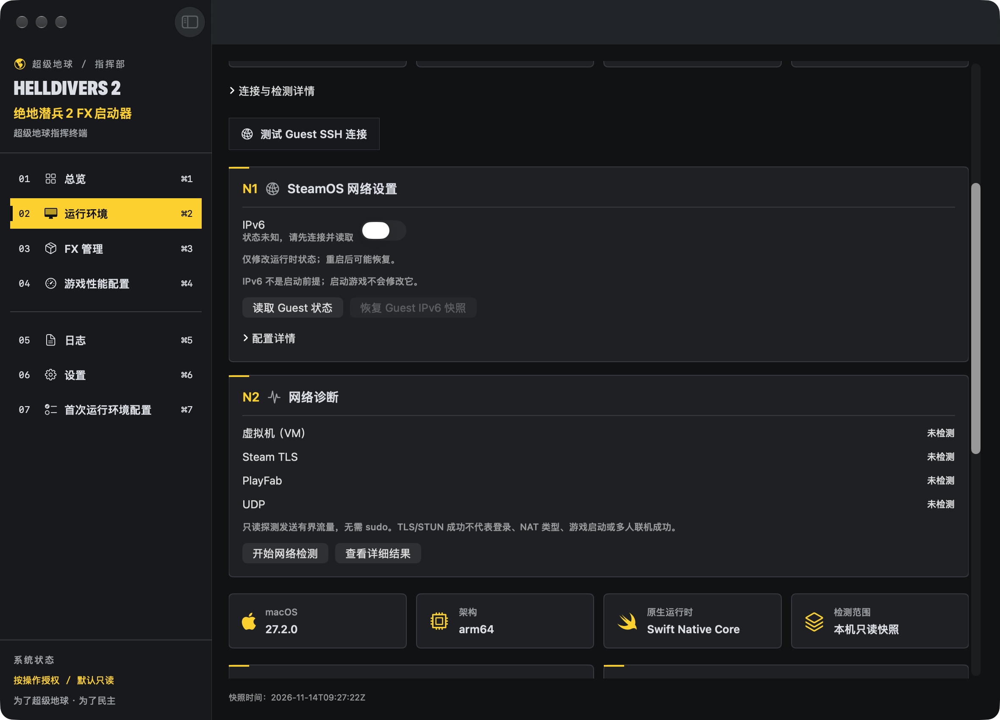

<div align="center">
  

**SSH 连接设置（未发布候选）：** 设置页新增地址、端口和用户名输入框，保存时校验配置版本、备份并清除会话凭据。隔离测试 FX 可填写 `127.0.0.1:2223`；不会修改 FX 或自动连接。中英文设置截图已于 2026-11-05 使用实际 Debug 候选 App 更新。真实连接尚待验收。
  <h1>HELLDIVERS 2 FX Launcher</h1>
  <p>为 Apple Silicon Mac 打造的 HELLDIVERS 2 FX 启动与管理工具。</p>
</div>

<a id="简体中文"></a>

[**English**](README.md) | [**简体中文**](README.zh-CN.md)


[软件截图](#zh-screenshots) · [主要功能](#zh-features) · [下载安装](#zh-installation) · [快速开始](#zh-usage) · [兼容性](#zh-development) · [更新日志](#zh-changelog) · [原脚本](#zh-legacy)

### 首次运行环境配置（独立开发版）

构建 `2026110602` 修复当前 Steam 实际接口与旧代码不一致的问题：分别读取启动参数和兼容工具，不再因工具查询失败丢弃已读到的启动参数，并显示具体技术错误。完整校验通过的 Proton 显示检测通过；已有目录与清单冲突时保留原目录。安装同时验证上游 SHA-512 文件、固定校验值、SHA-256 和完整目录清单。

配置确认包含自动正常重启 FX 虚拟机、等待 SSH 恢复并重新认证、核对同一 FX 安装和机器标识以及变化后的启动 ID，再配置 Steam 工具及启动参数并读回。只发送一次重启，不强制关机或盲目重复。重新认证且核验通过的 SSH 连接会保留给后续启动器操作，直到清除凭据、切换目标或退出 App；仅登记连接元数据，不保存密码。密码仍仅在进程内存中，仅这次已确认的重启允许受控更新绑定。已检查实际 Steam 的只读接口与读取结果；真实安装、重启重连和写入验收仍为 **NOT_TESTED**。新流程截图待补。

设置页截图已使用真实整合 Debug 构建 `2026110601` 更新，保留已保存的自定义 SSH 配置。

SSH 默认连接为 `127.0.0.1:2222`，用户名 `steamos`，无需手动填写即可使用。设置中的空白项保留当前有效配置（包括已保存的自定义值），仅保存已填写且有变化的项。

精确目标 `proton-je-11.0-20261014-3` 缺失时，“配置运行环境”从固定上游下载归档（332 MiB），校验 SHA-256、全部 5,609 个文件和 1,896 个符号链接，再安装，无需关闭 Steam。SteamOS 内需有 curl／Python 3，至少需 4 GiB 可用空间；未知已有目录保持不动。启动选项通过 Steam 在线接口读取，保留自定义参数后合并、写入并读回确认。兼容工具只在完整包校验通过且 Steam 已识别后通过 Steam 接口选择；配置确认后会自动重启 FX 虚拟机并重新连接 SSH，再选择兼容工具。检测仍只读，安装在配置确认后执行。包恢复将校验通过的安装目录保留到唯一的恢复名称下。Mac App 本身无需 Python 运行时。真实上游归档已通过生产安装器在本地隔离 HOME 下的安装、完整校验与恢复。真实 SteamOS 验收与新配置截图待补。

组件检测与部署权限分别显示：已发现的 FEX／Proton 在完整性确认前保持待验证，未知检测为中性状态；IPv6 为可选橙色提示，不阻塞其他配置。Proton-JE 只在限定工具目录内发现文件，不执行或自动选择未验证的工具。首次配置新截图待补。

FX 与 SteamOS 版本号仅用于诊断记录和历史证据，不作为版本白名单。首次配置保留架构、Guest 身份、组件／资源及安全写入检查；性能编辑保留包完整性、可用驱动、参数格式与硬件边界检查。新版本仍需通过实际能力检查，不代表游戏兼容性已验证。首次配置截图早于本次策略变更，新截图待补。

打开**首次运行环境配置**，选择 FX，分别输入仅供本进程使用的 SSH／sudo 密码，然后连接并检测。审阅目标身份、配置档和具体修改后点击**配置运行环境**。保持 SteamOS 与 Steam 运行，修改前仅需退出游戏。Steam 运行时通过在线接口配置其管理的设置；接口无法核实时阻止自动写入，可通过 Steam 属性手动设置后再检测。只选择已安装且已验证的工具，缺少审核资源仍受阻；无可自动执行项时显示原因。新截图及真实 SteamOS 验证待补。再次检测会跳过已正确配置的应用管理项。恢复功能仅使用本应用收据，核对当前值，遇到目标变化或外部修改就停止。

候选矩阵为 FX **1.9.8**／SteamOS **0.4.5**／**aarch64**／AppID **553850**。这是历史目标，不代表所有同版本安装都含有相同组件。FEX 再分发及其他 Proton-JE 版本仍需审核发行包及完整清单，保持 **BLOCKED**；固定的 Proton-JE 目标直接从上游下载并保留许可证。不分发私人 VM 文件。初始配置档不强制代理、gvproxy 替换、IPv4-only、CPU 亲和性或历史 CPU／内存／GPU 预算。硬件／FX 建议沿用现有受保护的性能页面。

组件来源、恢复规则、常见错误与测试边界见[实现报告](NATIVE_FIRST_RUN_DEPLOYMENT_IMPLEMENTATION.md)、[配置档矩阵](NATIVE_ENVIRONMENT_PROFILE_MATRIX.md)、[安全审查](NATIVE_DEPLOYMENT_SECURITY_REVIEW.md)、[测试结果](NATIVE_DEPLOYMENT_TEST_RESULTS.md)和[验收报告](NATIVE_FIRST_RUN_ACCEPTANCE.md)。缺失或不支持的版本需要新的审核配置档；`ARTIFACT_UNAPPROVED` 表示未尝试安装，`STEAM_RUNNING` 保护离线 Steam 文件写入；SteamOS 会话中应通过 Steam 属性设置后重新检测，`RECOVERY_REQUIRED` 会阻止后续部署，直到解决收据所记录的修改。配置写入成功不等于游戏、EAC 或多人验证通过。全新 VM 验收为 **NOT_TESTED**，Latest 未修改。


<a id="zh-overview"></a>

以 **SwiftUI + AppKit** 构建、**Swift 原生核心**驱动：启动游戏、检查所选 FX 环境、管理性能配置。七个页面职责清晰，默认深色，操作进度和结果在页面内显示，技术细节按需展开。Mac App 无需 Python 解释器、Python Bridge 或外部脚本目录；可选的 Proton 安装在 SteamOS 内使用 Python 3。

> [!IMPORTANT]
> **开发预览。** 正式安装包尚未发布。已完成的 Native 成果已整合到 [main](https://github.com/LSJOP/helldivers2-fx-launcher/tree/main)；[feature/macos-native-app](https://github.com/LSJOP/helldivers2-fx-launcher/tree/feature/macos-native-app) 保留开发历史。仓库不包含运行时二进制、游戏文件或 Guest 镜像。

<a id="zh-screenshots"></a>

七个页面直接展示主要内容，已移除重复的全局 FX 状态栏。FX 检测、版本、运行状态及资源诊断仍保留在 FX 管理与运行环境等对应页面。

## 软件截图

**Native 接管预览：** Guest SSH 已修正 OpenSSH 参数并使用控制终端，运行环境新增只读的“测试 Guest SSH 连接”。仅在 App 安全输入框中输入凭据。设置 → 关于显示并可复制随包构建身份。真实 Guest 密码认证与游戏仍需用户验收；隔离测试不代表真实验收。运行环境与设置截图已于 2026-11-04 使用真实 Debug App 更新；屏幕外的关于信息另做 Release 验收。全部页面截图现已展示本次精简后的布局。 SSH 专项检查在验证发布者签名或本地内容签名及父子关系后，可检查已运行的 FX 自带网络进程；游戏启动仍要求固定的内置后端。

七个页面及性能／更新详情视口已于 2026-11-04 在移除全局 FX 状态栏后重新拍摄，没有替代栏或预留占位。

[](docs/images/zh-CN/dashboard.png)

| 运行环境 | FX 管理 |
| --- | --- |
| [](docs/images/zh-CN/environment.png) | [](docs/images/zh-CN/fx-manager.png) |

<details>
<summary>游戏性能配置</summary>

[](docs/images/zh-CN/performance.png)

[](docs/images/zh-CN/performance-actions.png)

</details>
<details>
<summary>日志、设置与软件更新</summary>

[](docs/images/zh-CN/logs.png)
[](docs/images/zh-CN/settings.png)
[](docs/images/zh-CN/settings-updates.png)

</details>


十张当前简体中文截图来自实际整合 Debug App（0.1.0，构建 2026110411），涵盖七个页面、网络设置与滚动设置视图。原始像素未修改，采集副本隔离偏好，不连接或修改 Guest；不代表游戏或安装验收。[采集来源与限制](docs/images/README.md)。

<a id="zh-features"></a>

性能编辑现支持已固定构建的 **FX 1.9.4**：CPU、Guest 内存、实际可用的 Vulkan 驱动、Metal HUD。流程为读取 → 编辑 → 预览确认 → 自动备份并验证 → 写入并重新读取；恢复使用本系统的真实备份，外部修改会阻止覆盖。FX 运行时禁止写入，不会自动停止或重启。保存后需重新启动 FX／Guest，仍显示运行中配置未验证。原启动命令会覆盖参数，固定预检可能拒绝自定义值，使用原路径前应恢复备份。超分辨率与 6144 MiB GPU 预算保持只读，无性能提升保证。对应语言的当前截图已同步。[机制、范围与风险](docs/GAME_PERFORMANCE.md)。

## 主要功能

| 状态 | 功能 |
| --- | --- |
| 🟢 已实现 | 七页原生界面、Cmd+1…7 导航、深色／浅色／跟随系统、正式项目图标 |
| 🟢 已实现 | 限定范围本机／FX 发现；带校验、修订检查、备份和原子替换的配置编辑 |
| 🟢 已实现 | 可搜索、筛选、有容量限制且脱敏的日志与诊断报告 |
| 🟢 已实现 · 受保护写入 | 硬件／FX 偏好与参考对比；固定 FX 1.9.4 构建的限定参数编辑、备份与恢复 |
| 🟠 开发中 | 一键检测与 SSH 后台操作；原入口 FX／Steam 启动、SSH／sudo 独立凭据复用；新入口实机验收仍待完成 |
| 🟢 已实现 · 静态覆盖检查通过 | 原 Python 十语言资源单独保留；Native 统一资源覆盖全部十语言。缺失文案明确显示缺失键，不回退英文；译文自然度仍需人工审校 |
| ⚪ 计划中／不可用 | 安全停止／重启 FX、经过验证的性能推荐、签名／公证安装包 |

性能规则完全本地、可复现。原记录中的 **M4 Pro／24 GiB** 配置仅是候选基准，不代表全面性能验收。其他硬件不生成可写推算配置；限定参数支持预览确认、备份写入与冲突保护恢复；原启动参数覆盖及其他限制见下文。见[参数来源与限制](docs/GAME_PERFORMANCE.md)。

<a id="zh-requirements"></a>
<a id="zh-installation"></a>

## 下载与安装

**正式安装包尚未发布。** 仓库 [Releases 页面](https://github.com/LSJOP/helldivers2-fx-launcher/releases) 当前没有已发布版本；此链接不是不存在的安装包下载按钮。

源码预览需要 **Apple Silicon、macOS 14+、完整 Xcode／macOS SDK**。游戏操作需要已安装且由发行方签名的 FX Steam Launcher，以及可通过 SSH 连接的 FX Guest。启动所需的 gvproxy 资源已内置并通过 SHA-256 校验。

```sh
git clone --branch main --recurse-submodules https://github.com/LSJOP/helldivers2-fx-launcher.git
cd helldivers2-fx-launcher/native-app
./script/build_and_run.sh --xcode-only
open build/Debug/HD2FXNative.app
```

已有克隆需核对目标分支，并执行 `git submodule update --init --recursive`。源码 ZIP 不包含固定 Core 子模块。见[开发指南](docs/NATIVE_DEVELOPMENT.md)。

<a id="zh-usage"></a>

## 快速开始

1. 打开 App，在设置中选择语言与外观，然后在 FX 管理中选用已安装的 FX Steam Launcher。
2. 原生 App 使用内置资源，无需选择脚本目录。“一键检测”只读检查 Guest，要求 FX 已运行；需要时先在 FX 管理中点击“启动 FX”。
3. 在总览点击“启动 HELLDIVERS 2”，原有启动流程自动完成必要检查。核对启动确认及具体配置变更预览；密码仅填写 App 安全输入框。
4. 在游戏性能配置页查看硬件与基准差异，在日志页查看错误详情。检测到进程不代表已经进入主菜单。

<a id="zh-development"></a>

## 兼容性状态

| 证据 | 当前结果 |
| --- | --- |
| Native App | Debug 构建、七页冒烟检查通过；本轮定向检查为 35 项迁移及 9 项推算用例 |
| FX／游戏进程 | 此前记录中的专用 FX 1.9.4 启动已观察到；不代表任意 FX 安装均兼容 |
| 主菜单／可操作飞船 | 2026-11-03 用户明确确认，限定于该记录环境 |
| 当前 GUI SSH／Guest 读取 | 已连接真实后端；最近宿主检查因另一份 FX 正在运行，在连接前拒绝。新入口的成功实测仍待完成 |
| 单人任务／独立 EAC 验收／多人联机 | 分别保持**未验证** |
| 性能 | 受保护的偏好编辑与备份恢复，没有实测性能保证，也不自动调优 |

> [!WARNING]
> 发现安装 ≠ 运行就绪 ≠ 游戏进程已启动 ≠ 进入主菜单 ≠ EAC 验证成功 ≠ 多人联机成功。不提供反作弊绕过。

<a id="zh-changelog"></a>

## 更新日志

尚未发布任何正式版本；当前原生版本 `0.1.0` 为开发预览。近期未发布改动：

- 原生七页界面、限定范围 FX 发现、带校验的配置编辑、脱敏日志与只读性能比较。
- GUI 化 FX／SSH 操作与仅保留在进程内存中的独立 SSH／sudo 凭据。
- Sparkle 2 更新集成（Feed／签名服务尚未配置）。

完整历史见 [CHANGELOG.zh-CN.md](CHANGELOG.zh-CN.md)。

## 常见问题

- **为什么停止／重启或部分应用按钮禁用？** 正常退出后端尚未验证。性能编辑只支持固定 FX 1.9.4 构建，需读取合法配置、FX 停止并预览确认；无有效备份或外部修改会阻止恢复。App 不强制停止 FX。
- **每次都要输入密码吗？** App 退出或所选环境变化后需要重新输入。SSH 与 sudo 密码相互独立，只能在当前进程内验证后复用；不写入文件、偏好设置、命令行参数、环境变量或 macOS 钥匙串。可在设置中立即清除两种凭据。
- **自动更新能用了吗？** 在「设置 → 软件更新」可手动检查 GitHub Native 发布。默认稳定版；正式服务未就绪前，预览渠道及自动检查保持关闭。安全下载需要可信 Ed25519 公钥与签名清单；缺少签名 Appcast、Developer ID、公证及分发条件时禁止安装。手动检查不会自动安装；自动检查开关需签名服务就绪才可启用。下载校验包含签名、大小与 SHA-256，安装仅由官方 Sparkle 执行。目前尚无正式更新包，失败保留当前 App，不把下载成功视为安装或重启成功。发布准备复用历史更新源前会先验证其签名。[配置和发布条件](docs/NATIVE_UPDATES.md)。

<a id="zh-legacy"></a>

## 开发文档与原脚本

- [main](https://github.com/LSJOP/helldivers2-fx-launcher/tree/main)：已整合 Native 成果的主线。
- [feature/macos-native-app](https://github.com/LSJOP/helldivers2-fx-launcher/tree/feature/macos-native-app)：保留 Native 开发历史，后续复用前需安全同步 main。
- [legacy-script](https://github.com/LSJOP/helldivers2-fx-launcher/tree/legacy-script)：原脚本归档，保留历史。
- [开发指南](docs/NATIVE_DEVELOPMENT.md) · [迁移证据](docs/FUNCTION_MIGRATION.md) · [性能配置](docs/GAME_PERFORMANCE.md) · [自动更新](docs/NATIVE_UPDATES.md) · [开发规则](AGENTS.md)

<a id="zh-disclaimer"></a>
<a id="zh-license"></a>

## 免责声明与协议

本项目非官方，不宣称获得官方认可，不保证兼容性。HELLDIVERS 2 及相关标识归各权利人所有。项目统一源码许可证**尚未选定**，不应推定均可自由再分发。见[权利与来源说明](THIRD_PARTY_NOTICES.md)，其中保留 Sparkle 的独立许可证和用户提供素材的来源。

开发检查：`native-app/script/run_checks.sh` 编译并运行原生核心契约检查、十语言门槛与文档检查。Python 用于开发脚本及 SteamOS 内的可选安装器；Mac App Bundle 无需 Python 运行时。界面变更必须审查中英文 README 及真实截图。历史截图保留各自构建记录，本次设置页截图已更新，配置部署状态新截图待补；译文自然度仍需人工审校。发布检查 Actions 模板保持未启用，尚未配置 CI 工作流。

FX 选择 V2 + 自动选择 V2.1：FX 管理、总览和启动窗口共享并持久化同一个默认 FX。扫描结果中只有一个通过身份和路径验证的 FX 时自动选择；多个 FX 时保留有效默认，否则请用户选择。默认 FX 删除、移动或更新后重新验证。选择后仍显示**启动能力待验证**，不会自动启动游戏。每次启动先重扫默认 FX，并为检查、预检和执行固定同一份所选路径。完整性校验接受通过 Apple 信任锚、Bundle ID 与 Team ID 校验的 FX 发布者完整签名，或可识别且内容签名完整的本地副本；再次核对可执行文件摘要，并保留全部原有配置、进程和 Guest 检查。这不代表游戏兼容性已经验证。启动资源已内置于原生 App，无需原始脚本目录或 Node 辅助程序。停止／重启仍不可用。限定参数性能编辑支持已验证且停止运行的 FX 1.9.4／1.9.8，并需明确预览与确认；FX 写入不再按版本号拦截，仍需通过实际能力与安全检查。

启动资源：原生 App 内置通过 SHA-256 校验的 gvproxy 与包装器。资源缺失、改动或符号链接均拒绝执行，不修改 FX 文件。本机发现检查与 Guest／游戏兼容性分别验收。

sudo 排查（2026-11-04）：构建 2026110402 存在远程空提示符参数引用缺陷。相关修复及 sudo/SSH 错误分类正在验证，尚未发布替代构建。真实只读检查已通过完整 Guest 身份确认；带密码 sudo 及后续启动阶段仍未验证。

**当前凭据实现：** 本候选版保留 Guest 身份绑定、仅内存的独立 SSH／sudo 凭据、逐次认证和脱敏；首次配置也使用同一服务。真实特权修改、全新 VM、游戏及联机仍为 NOT_TESTED。本次整合合并至 main，新的本地 App 从干净的整合快照构建。


**SteamOS 网络候选（未发布）：** 运行环境 → SteamOS 网络设置提供主动开启/关闭 IPv6、精确确认、备份与验证恢复。首次配置仅将 IPv6 作为诊断提示，它不阻塞部署，游戏启动也不会修改它。VM、Steam TLS、PlayFab、UDP 为手动只读探测，不申请 sudo，检测通过不代表多人联机已验证。凭据仅保留在本次进程内存中，授权绑定当前连接。真实 Guest 写入及游戏启动仍为 NOT TESTED。[网络使用说明](docs/STEAMOS_NETWORK_SETTINGS.md) · [Python → Swift 功能矩阵](docs/PYTHON_TO_SWIFT_FEATURE_PARITY_AUDIT.md)。

[](docs/STEAMOS_NETWORK_SETTINGS.md)


[首次配置合并与 Latest 构建记录](NATIVE_FIRST_RUN_MAIN_MERGE_REPORT.md)。

验收进行中：所选 FX 与自动发现结果统一去重。本机已安装且可发现 FX 1.9.9；性能写入取决于实际能力与安全检查；真实 Guest／游戏验收及正式分发仍待完成。参见[验收报告](docs/acceptance/FULL_SYSTEM_ACCEPTANCE_REPORT.md)。

本次游戏启动完成且检测到游戏进程后，启动弹窗自动关闭；错误、取消或未验证结果仍保留显示。进程检测不等于主菜单或多人联机通过。此次自动关闭行为待下一次真实 GUI 启动复核，现有截图不作为其验收证据。

首次运行环境配置统一从侧边栏进入；已移除总览主视觉上方的重复入口。

总览截图已于2026-11-05使用隔离的真实Debug窗口更新（build 2026110503），展示首次只读快照加载期间的布局，不作为运行状态验收证据；其他截图保留各自记录的构建来源。

FX 管理也显示本地测试身份 `es.fxgam.steamtc`。完整本地签名副本无需官方发布者签名即可通过普通启动确认启动，并标注为本地测试副本；仍核对路径、内容签名、进程父子关系及 SSH 端口。此改动不启用自定义副本的性能配置写入，也不证明 Guest／游戏兼容。

首次运行环境配置与启动页共用官方／本地副本入口校验。全新测试 Guest 仍需独立验证 SSH／sudo，并通过部署能力与审核资源检查；识别副本不代表这些前提已经完成。

### FEX 候选审核（开发中）

动态 FEX 改动前的历史记录。首次运行环境配置新增**审核候选、构建候选、部署已审核候选、恢复原组件**。构建使用固定 FEX 源码提交和已审核 RF 补丁，在独立 Guest 目录进行；保留当前安装，核对完整运行时清单及历史可执行文件哈希，并保留备份用于受保护恢复。陌生产物继续受阻。真实 Guest 候选构建已成功，但可执行文件哈希与历史策略不同，因此部署仍受阻。真实部署、恢复和游戏验收待完成，详见[流程与证据](docs/environment/FEX_CANDIDATE_PIPELINE.md)；该界面流程不要求用户手动在终端安装。

### 自动准备候选版

首页启动与独立首次配置页现在共用环境准备流程。需要时启动选定 FX，恢复匹配环境的加密凭据，检测真实环境，执行已审核变更并重新验证，随后请求启动游戏。独立配置页在验证后结束。重启虚拟机需要确认，游戏运行时禁止重启。百分比表示已完成的流程步骤，长任务内部使用无法量化的加载动画。

动态 FEX 改动前的历史记录。本候选版修复部署版本号包含 Steam VDF 无关元数据的问题。管理项发生外部变化、离线目标文件发生变化仍会阻止写入。已安装且可通过版本探测的审核基线 FEX 与候选包审核独立判断，其他 FEX 版本保持未验证。实机已验证 SSH/sudo、Proton-JE、Steam 兼容工具和受管启动参数。两个 GUI 入口均在 FEX 审核处停止，当前安装的可执行文件与审核基线不符。游戏进程、主菜单、EAC 和多人联机仍未验证。


### FEX 动态兼容性（开发中）

FEX 兼容性先检查 ARM64 ELF、执行权限与 Steam 集成，再执行限时 12 秒的 x86-64 基础运行测试。完整安装目录指纹将确认记录绑定到当前环境，游戏启动请求前再次复检。来源未验证的构建需先确认才执行，运行测试通过后进入兼容模式，来源状态仍独立保留。文件变化使原确认失效。候选部署继续要求固定源码来源、完整清单、备份与恢复，取消历史可执行文件哈希准入。首页与首次配置共用该服务。真实兼容性、主菜单、反作弊与多人联机验收仍待完成。中英首页与首次配置截图来自当前只读界面。
