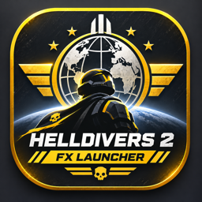
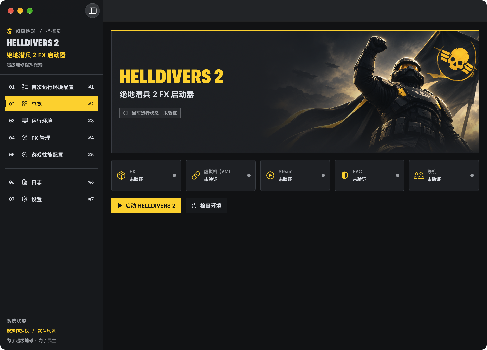
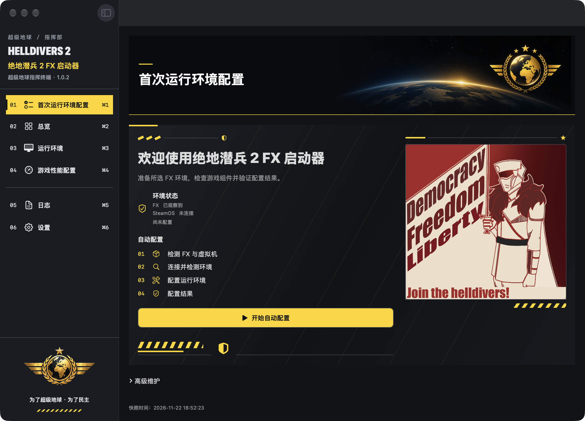
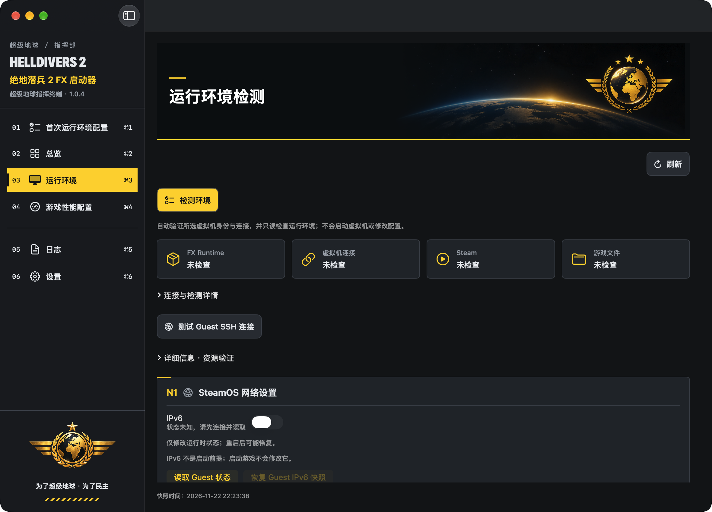
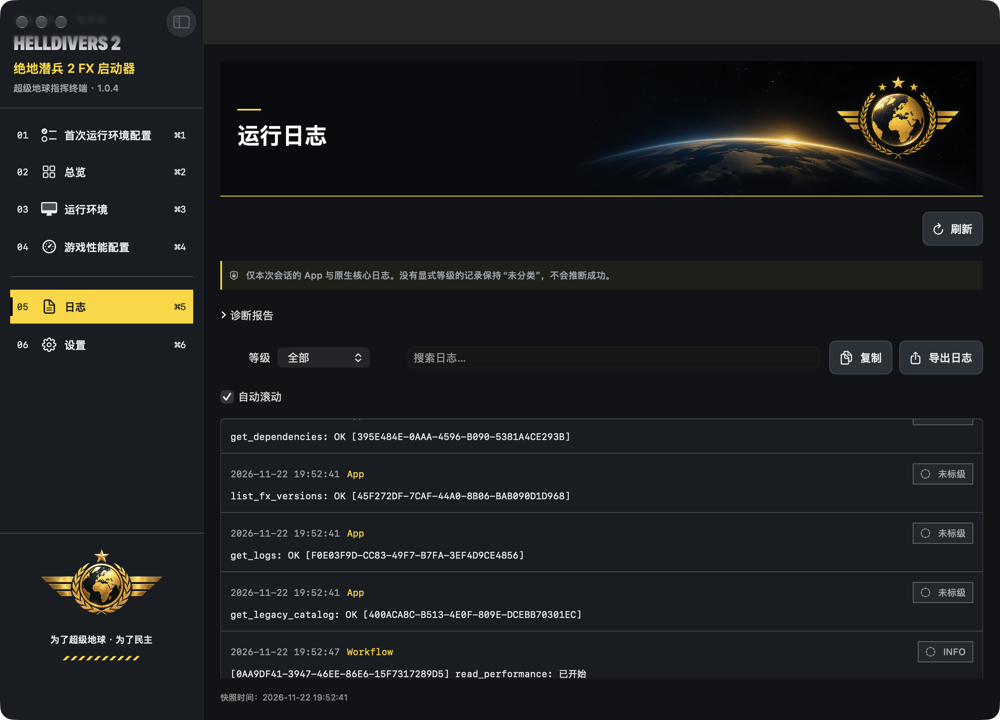
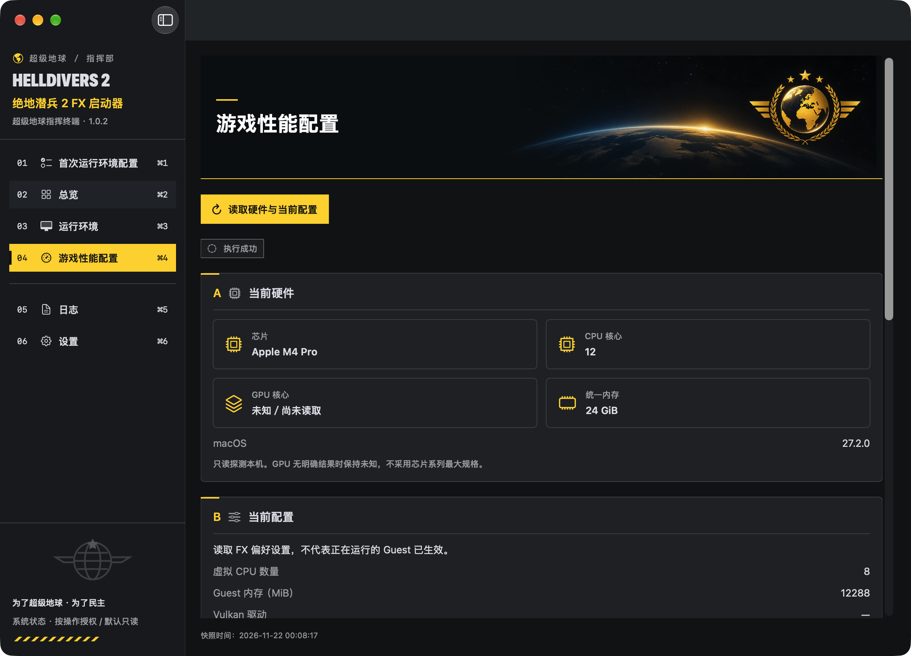
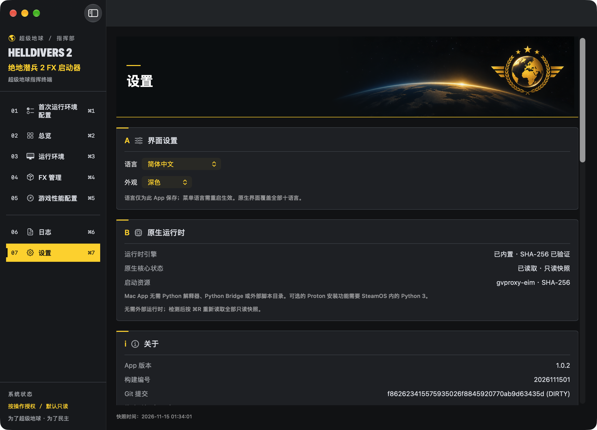

  
  <h1>绝地潜兵 2 FX 启动器</h1>
  
HELLDIVERS 2 FX Launcher · Apple Silicon macOS

[简体中文](README.zh-CN.md) | [English](README.md)

<!-- stable-download:start -->
### [🟨 ⬇️ 下载 绝地潜兵 2 FX 启动器 最新正式版](https://github.com/LSJOP/helldivers2-fx-launcher/releases/latest/download/HD2FXNative-v1.0.5-macOS-arm64.dmg)

**🟨 Stable Release · v1.0.5** · **macOS · Apple Silicon / arm64**

**[⬇️ 立即下载 DMG](https://github.com/LSJOP/helldivers2-fx-launcher/releases/latest/download/HD2FXNative-v1.0.5-macOS-arm64.dmg)** · [查看所有版本](https://github.com/LSJOP/helldivers2-fx-launcher/releases)
<!-- stable-download:end -->

## 简体中文

绝地潜兵 2 FX 启动器是面向 Apple Silicon Mac 的第三方社区启动与管理工具，使用 SwiftUI 和原生核心，帮助用户检查 FX 环境、配置运行环境和管理游戏性能设置。

FX 1.9.9 测试盘已恢复历史验证的 RF 运行组件，通过 GUI 启动游戏，主菜单／飞船获用户确认；单人、多人及自动更新完整闭环仍未测试。正式 FX 1.9.12 仅离线只读调查。见[修复证据](docs/environment/FX199_RF_REPAIR_20261114.md)。

### 软件截图

截图来自隔离 Debug 构建。软件更新面板的截图使用捕获专用 App，服务显示未配置。见[截图记录](docs/images/README.md)。

总览 V003 集中提供基于路径的 FX 实例选择与控制，运行环境保留高级诊断。滚动条隐藏，页面仍可滚动。四张状态卡显示 FX、Steam、EAC 和联机，Guest 证据在运行环境查看。

| 总览 | 首次运行环境配置 |
| --- | --- |
|  |  |
| 运行环境 | 日志 |
|  |  |
| 游戏性能配置 | 设置 |
|  |  |

### 主要功能

配置与启动流程美术作品由 **MOTR7** 创作，经作者授权使用（由用户提供）；首页主视觉和统一页面横幅保持不变。开发候选将首次配置置于侧边栏第一位（⌘1），默认页面仍为总览（⌘2）。

**界面更新：**运行环境和日志页使用统一的内容区快照刷新；FX 详情复用检测结果，避免界面重绘时反复计算哈希。

日志页使用系统本地时间，实时显示有容量限制的任务事件，支持自动滚动和导出脱敏的原始 ISO 8601 时间戳。启动命令成功、游戏进程、窗口和实际进入游戏分别记录；窗口及游戏内状态不会自动推断。

- 从总览发起带保护检查的 HELLDIVERS 2 启动流程。总览提供实例选择及受支持的 FX 启动操作。
- 首次运行环境配置检查 Guest 身份、运行能力和组件完整性。经确认后可安装固定版本的 Proton-JE、选择已验证的 Steam 兼容工具，并合并启动参数以保留自定义参数。检测为只读，部署与恢复各有检查条件。
- 运行环境页面报告 FX 运行环境 和 Proton-JE 的检测依据。SSH 和 sudo 凭据可针对已验证目标分别加密保存在本地；跨重启复用仍需实机验收。
- Swift App 提供六个原生页面、日志、限定范围的性能设置和十种界面语言。SteamOS 内的可选安装步骤需要 Python 3。
- 在「设置 → 软件更新」中检查稳定版。v1.0.1 无法安装已发布的 v1.0.2 更新 ZIP，请使用 DMG 安装 v1.0.2。

### 安装说明

<!-- stable-install:start -->
当前 App：`1.0.5`（构建 `2026112501`），适用于 macOS 14+ Apple Silicon arm64。采用 ad-hoc 签名，无 Apple Developer ID 签名，未经 Apple 公证。Gatekeeper 可能拦截下载副本；打开前核对 [SHA-256 文件](https://github.com/LSJOP/helldivers2-fx-launcher/releases/latest/download/SHA256SUMS.txt)。若被拦截，对已核验 App 使用「隐私与安全性 → 仍要打开」。
<!-- stable-install:end -->

1. 从正式 Release 下载 macOS arm64 DMG。
2. 运行 `shasum -a 256 <下载的 DMG>`，与发布说明中的 SHA-256 比对。匹配后打开 DMG。
3. 将 App 拖入「应用程序」。
4. 打开 App。
5. 在总览中选择已安装的 FX Steam Launcher，按首次运行向导操作。SteamOS 内须安装 Steam 和 HELLDIVERS 2（AppID 553850），使用拥有游戏的账号，并确保 Guest 可通过 SSH 访问。在 App 内输入所需凭据并审核拟执行的变更。
6. 在总览点击「启动 HELLDIVERS 2」。

从源码构建请参阅[开发指南](docs/NATIVE_DEVELOPMENT.md)。

### 已知问题

FX 1.9.9 历史实测记录了游戏主菜单及飞船。单人、EAC、多人及全新环境部署仍待验证。

- FX 和 SteamOS 兼容性取决于所选构建和实测能力。当前启动路径有已记录的代理不匹配问题。安全停止或重启 FX 暂不可用。
- 实验性 FX 运行组件候选曾在真实 Guest 中构建成功，但可执行文件的哈希未通过部署审核。候选的安装、恢复和游戏兼容性均待验证。其他 Proton-JE 构建和全新 SteamOS 部署仍需验收。
- 首次配置现在会在 FX 运行组件缺失时自动进入修复，并区分权限、可执行位、架构、完整性和实际运行失败。公开 RF 资源及已验证备用下载仍待完成来源和再分发审核，因此全新用户安装会如实阻塞，不会使用未经审核的二进制。
- 11 月 5 日的历史 Native 构建曾进入游戏主菜单／舰桥。正式包启动、单人任务、EAC 和多人联机仍需分别验证。
- v1.0.1 会在 ZIP 安全检查时拒绝已发布的 v1.0.2 更新包，请使用 DMG 升级。App 使用 ad-hoc 签名且未经公证，可能受到 Gatekeeper 拦截。
- [验收报告](docs/acceptance/RELEASE_READINESS_REPORT.md) · [已知问题详情](docs/acceptance/KNOWN_ISSUES.md) · [首次运行验收](docs/testing/NATIVE_FIRST_RUN_ACCEPTANCE.md) · [更新机制](docs/NATIVE_UPDATES.md) · [性能设置限制](docs/GAME_PERFORMANCE.md)

### 更新日志

<!-- stable-version:start -->
[v1.0.5 — 2026-11-25](https://github.com/LSJOP/helldivers2-fx-launcher/releases/latest) · 正式稳定版，构建 `2026112501`。见[发布说明](CHANGELOG.zh-CN.md)。
<!-- stable-version:end -->

当前功能状态、验证范围和未合并成果见[功能索引](docs/FEATURE_REGISTRY.md)、[更新日志](CHANGELOG.zh-CN.md)及[原版启动器历史](https://github.com/LSJOP/helldivers2-fx-launcher/tree/legacy-script)。

### 免责声明

本项目由社区开发，与 HELLDIVERS 2 官方无关联，相关名称及商标属于各自权利人。项目尚未选定全项目源码许可证；第三方组件与素材说明见 [THIRD_PARTY_NOTICES.md](THIRD_PARTY_NOTICES.md)。

### 文档

使用与开发指南、架构说明和历史报告见[文档索引](docs/README.md)。

接续开发请读取[当前状态](docs/DEVELOPMENT_STATUS.md)和[交接文档](docs/NATIVE_APP_DEVELOPMENT_HANDOFF.md)，以 main 源码与 AGENTS.md 为准，未合并候选及实机验收单独记录。

原生更新中断后，下次打开 App 可恢复事务。

FX 1.9.9 环境实测记录见[运行环境基线报告](docs/environment/FEX_BASELINE_REPORT_20261115.md)。

首次配置会区分 Proton 内置 FX 运行环境与独立运行组件缺失，记录 Proton 版本、配置及库文件哈希；取得已审核方案之前明确显示兼容性未验证。

v1.0.5 提供组件更新引擎，并为旧正式版保留小体积 ZIP。后续兼容版本可复用校验匹配的内置组件，并保留已验证的全量 ZIP 备用。三个历史运行组件仍限受控测试。若应用内更新失败，请核验并挂载完整 DMG，退出启动器后替换现有 App。已保存设置和 SteamOS 镜像继续使用。见[组件更新验收](docs/testing/COMPONENT_UPDATES_ACCEPTANCE.md)。

环境配置分支优先使用 App 内置的 FX 运行组件和 Proton-JE，以获批的固定版本和哈希校验下载为备用。Steam Linux Runtime 4.0 由 Guest 内的 Steam 管理。缺失时需要 Steam 联网，已验证兼容的安装会复用。FX 和 Proton-JE 的公开分发审批与真实部署验收仍待完成。见[部署验收报告](docs/testing/RF_FEX_BUNDLED_DEPLOYMENT_ACCEPTANCE.md)。

早期恢复工作已接入固定版本 Runtime 的隔离 Debug 安装（已验证本地归档或 Valve HTTPS、SHA-256、SFTP、保留 ARM64 Runtime、事务恢复）。公开版一键配置仍受 RF 二进制来源／再分发许可审核阻塞；Debug 回放需明确传入测试镜像与资源目录。见[首次配置验收](docs/testing/NATIVE_FIRST_RUN_ACCEPTANCE.md)。

持久部署候选：实测确认 Steam 在重启后更新自身运行组件 depot。恢复分支改为 App 管理目录部署 RF，并验证真实 Runtime 容器中的 RootFS。主窗口启动／重新打开及当前中英文空闲界面截图已修复；最终重复配置、跨重启验收及完整 RF 合法分发仍待完成。
