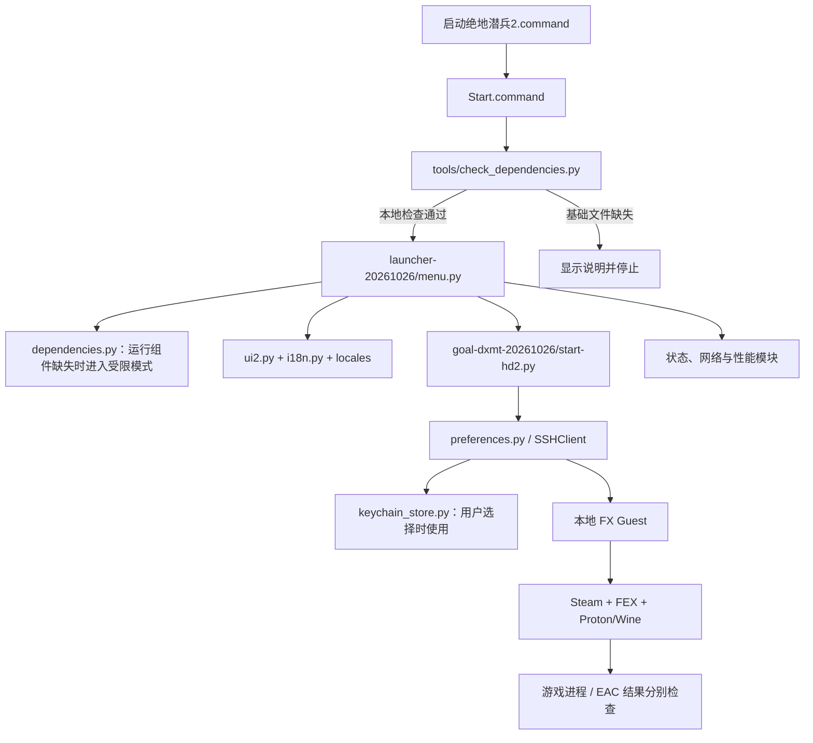

# 项目架构 / Architecture

[README](../README.md) · [贡献 / Contributing](../CONTRIBUTING.md)

## 简体中文

这是当前源码的结构，不是尚未实现的安装器或 SwiftUI 方案。所有路径都相对仓库根目录。

| 模块 | 当前职责 |
| --- | --- |
| [`Start.command`](../Start.command) / [`中文入口`](../启动绝地潜兵2.command) | 查找 Python、先检查启动器基础文件，再打开菜单；运行组件只限制启动／配置动作；中文入口委托同一实现。 |
| [`check_dependencies.py`](../tools/check_dependencies.py) | 检查本机工具、Node 功能和指定本地组件哈希，不建立 SSH 或启动应用。 |
| [`menu.py`](../launcher-20261026/menu.py) / [`ui2.py`](../launcher-20261026/ui2.py) | 菜单调度、终端绘制和键盘操作。 |
| [`start-hd2.py`](../goal-dxmt-20261026/start-hd2.py) | FX 启动、Guest 环境检查、Steam 启动项与游戏请求、EAC 新日志检查。 |
| [`preferences.py`](../launcher-20261026/preferences.py) / [`keychain_store.py`](../launcher-20261026/keychain_store.py) | 用户设置、SSH 认证和可选密码存储。 |
| [`status_monitor.py`](../launcher-20261026/status_monitor.py) | 后台状态采集；状态不足时保留未检查／未确认。 |
| [`network_profile.py`](../launcher-20261026/network_profile.py) | 用户主动选择的有线网络方案及恢复。 |
| [`network_diagnostics.py`](../launcher-20261026/network_diagnostics.py) / [`network_records.py`](../launcher-20261026/network_records.py) | 有限探测、诊断历史、脱敏快照与连接摘要。 |
| [`performance_profile.py`](../launcher-20261026/performance_profile.py) | 带备份和运行中保护的 FX 性能配置。 |
| [`steam-cdp.mjs`](../launcher-20261026/steam-cdp.mjs) / [`gvproxy wrapper`](../goal-fx-multiplayer-20261026/gvproxy-eim-wrapper) | Steam 控制桥与网络程序启动封装；不包含 gvproxy 二进制。 |

### 数据与副作用

用户设置存放在 `~/Library/Application Support/Helldivers2FXLauncher/`；选择保存的密码进入 macOS Keychain。运行生成的备份／报告和诊断记录应留在用户机器，不进入仓库。SSH socket 是临时运行数据。

首次语言初始化使用 CoreFoundation 读取 AppleLanguages，仅在没有保存的手动选择时匹配系统首选列表，失败静默使用 English。游戏运行依赖由 dependencies.py 分层检查；Guest 未验证项不会冒充缺失。

本地依赖检查与离线 UI 绘制不等于完整运行环境检查。菜单中的启动、性能配置和网络应用可能写入配置、建立认证、重启 Guest Steam 或关闭 Wi-Fi；修改这些路径需单独评审和隔离验证。状态刷新、游戏进程与 EAC 校验分别承担不同证据责任。

### 当前边界

固定的 FX 相对路径、组件哈希、资源预算和代理假设仍存在，详见[依赖](DEPENDENCIES.md)。此项目尚未实现自动安装器、通用网络适配或桌面 `.app`。后续架构演进以[发布计划](ROADMAP.md)为准。

## English

The diagram above describes the existing terminal implementation. The Chinese shortcut delegates to `Start.command`, which checks launcher-only prerequisites before calling the menu. Missing game components enable limited mode. The menu composes presentation/status modules and the existing Python backend. That backend connects through `SSHClient` to the local FX Guest, where Steam, FEX and Proton/Wine run the game. Game-process detection and EAC verification remain independent.

The table links to the actual source files. Settings live under the user’s Application Support directory; opted-in password storage uses Keychain. Runtime backups, reports, diagnostics and SSH sockets stay outside version control.

Local dependency checks and offline UI rendering do not establish live compatibility. Launch, performance and wired-network actions can change settings or runtime state and require separate review and isolated validation. The current code retains fixed FX paths, hashes, resource budgets and proxy assumptions. An automatic installer, general networking support and a desktop `.app` are future work, not existing architecture.

版本由 [VERSION](../VERSION) 经 launcher_version.py 提供；UI 2.0 仍是界面名称。Python/Node 安装脚本与入口共用 tools/runtime_paths.sh，Node 版本／功能由 tools/check_node.cjs 探测。这些辅助工具不执行游戏准备流程。

Release identity comes from [VERSION](../VERSION). Setup and Start.command share runtime path selection; the Node probe is local-only. These utilities do not replace the game backend.
