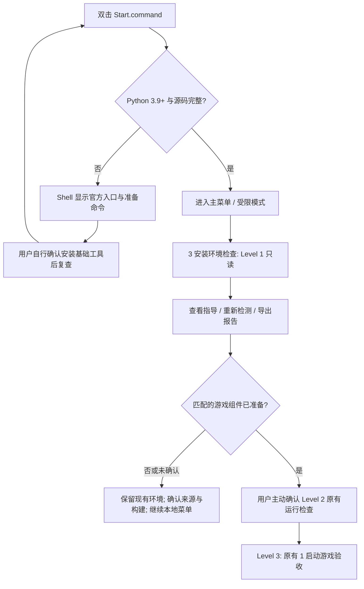

# 安装与部署 / Setup guide

[README](../README.md) · [完整依赖清单 / Inventory](DEPENDENCIES.md) · [AI 安装 / AI guide](AI_INSTALL.md) · [用户数据 / User data](USER_DATA.md)

## 简体中文

> [!WARNING]
> 当前是源码 Preview，尚未提供完整兼容游戏环境的一键安装。已有 M4 Pro 运行反馈不能证明新 Mac 部署成功。不要重装、替换或重置已能运行的环境。

### 新设备流程



### 1. 先打开菜单，缺组件也能使用

保留完整项目文件夹，双击 `Start.command` 或 `启动绝地潜兵2.command`。Python 3.9+ 和基础源码满足即可进入菜单；Node、FX、gvproxy 缺失不会退出。Shell 不安装软件、不运行 sudo、不修改 profile。Python 缺失时仍能看到官方入口和按实际目录生成的可复制命令，不依赖 Python UI。

**从 `[3] 运行环境检查` 进入安装检查中心**。这里采用无状态引导：不保存“完成”标记，不强制每次弹窗，也不改写设置。原因是现有设置保存器过滤未知字段，不能为了记忆向导而丢失用户数据。未完成部署可随时从 `[3]` 返回；首次缺依赖时入口会提示这条路径。

### 2. 检查／准备 Python 和 Node

先在终端输入 `cd` 和空格，把含 `Start.command`、`tools` 的实际项目文件夹拖入，再回车；ZIP、Git Clone、任意中文／空格目录都适用。

```bash
/bin/bash tools/install_dependencies.sh --check
```

需要安装时，**先核对输出并确认**：

```bash
/bin/bash tools/install_dependencies.sh
```

已符合条件的工具跳过。仅通过已有原生 Homebrew 经 `y` 确认安装缺失的 `python@3.14`／`node@24` 及其依赖；这两项是现有配方选择，不宣称所有版本都完成游戏验收。无 Homebrew 时仅提供 Homebrew 官方说明或 Python/Node 官方安装包选择，不执行远程安装器。安装后自动复查，Start 与安装器共用 Python 路径规则，不更改系统环境变量。

Node 是运行操作工具，**不是 UI 基础依赖**；需要 22+ 和全局 `fetch`、`WebSocket`。不要盲目重装已有工具或覆盖系统 Python。错误与修复路径见[AI 指南](AI_INSTALL.md)。

### 3. 阅读九项安装指引

`[3] → [1] 查看安装指引` 提供：基础依赖、FX、FEX、Proton-JE、网络组件、Steam 与游戏、SSH 设置、本机验证、报告导出。

各页显示最近一次本机检测证据、用途、已知版本边界、来源文档、可执行的下一步及当前阻塞项。长页用方向键、Page Up/Down 滚动，Esc／0 返回。**这些页面不执行安装**，也不读取密码。SSH 页仅在用户另选“打开现有 SSH 设置”时委托原有菜单。

精确位置、哈希、上游来源与安装状态统一查看[依赖表](DEPENDENCIES.md)和 manifest。对 FX/FEX/Proton-JE/gvproxy，缺少来源或匹配构建流程时停止，不猜下载地址，不用上游 latest 替代。当前未自动发现其他 FX 安装位置；“要求位置未找到”不是全局缺失结论。

### 4. 理解验证分级

| 级别 | 如何进入 | 实际行为 | 不能证明什么 |
| --- | --- | --- | --- |
| Level 1 本机静态检查 | `[3]` 默认／重新检测 | 平台、Python、源码、Node 本地功能、SSH 工具与配置结构、指定 FX/gvproxy 文件／权限／哈希 | 不启动任何组件、不探测网络、不连接 SSH；不能证明 Guest、游戏、联机可用 |
| Level 2 原有运行检查 | `[3] → [4]` 后主动确认 | 委托既有环境检查；按其原条件可能建立 SSH、使用保存选项并更新 known_hosts | 不安装组件；仅端口或进程不证明目标身份／兼容性／多人成功；具体检查限制沿用旧链路 |
| Level 3 游戏验收 | 原有 `[1] 启动游戏` | 原有依赖、安全确认及启动流程 | 启动、EAC、UDP、真实联机是不同证据，不可互相替代 |

`menu.py --check`／`--report` 是原有运行工具，不是纯 Level 1；配置完整时可能连接 Guest。仅需要静态结果请用以下新命令：

```bash
/bin/zsh Start.command --setup-check
/bin/zsh Start.command --setup-report
```

新命令返回 0 仅表示清单／报告生成成功，具体就绪状态应看内容，不代表游戏可用。第二条**主动新建**脱敏安装报告。没有 Python 时先准备基础工具；不会为验证自动启动 FX、Steam 或游戏。

状态含义：已就绪仅代表本项检查；已存在则跳过安装、版本和运行未必验证；版本／功能不匹配不触发覆盖；检测失败保持未知；Guest 组件显示“需要 Guest 环境”。设置结构有效也不等于身份和密码已验证。源码完整性仅为所需文件可读、可解析，不是签名或可信哈希基线。

### 5. 报告与环境保护

仅点击导出或使用 `--setup-report` 才新建报告，权限 `0600`，默认在实际设置路径同目录的 `reports/installation/`。目录可随 `HD2FX_SETTINGS_FILE` 改变。报告含版本、macOS、芯片／内存、状态、检测方法、缺失与待验证项、修复方向；不含用户名、SSH 地址／密码、Keychain、Token、用户路径、原始配置或诊断历史。

安装引导不调用设置保存器，不重置未知字段，不改变性能、网络、Guest 或已安装组件。FX、FEX、Proton、Steam 的存在或版本未知都不授权覆盖。若误把组件放错位置，先核对来源和路径，**不要为通过检查移动、重装或删除现有可用环境**。

### 当前未闭合的验收

全新 Apple Silicon Mac 的真实安装、精确补丁包／Guest 映像来源与可再分发审查、最低 macOS 与更多硬件、通用 FX 路径、独立 Guest 工具能力探针和通用网络适配。当前只能使这些阻塞可见，不能宣称已支持完整独立部署。在线更新仍仅查询，不开放安装。

## English

> [!WARNING]
> This source Preview is not a complete fresh-Mac game installer. Historical M4 Pro observations are not fresh-install evidence. Keep an existing working environment intact.

### First device workflow

1. Keep the complete folder and open **Start.command**. Python 3.9+ and intact UI sources permit the menu. Missing Node or game components enables limited mode. If Python is absent, Shell displays official choices and copyable commands using the real folder path; no Python UI is required for that message.
2. Open **[3] Environment check** for the Level 1 setup center. Guidance is stateless, writes no completion flag and never forces a wizard at every startup. The existing settings serializer filters unknown fields, so it is deliberately not used to remember setup progress.
3. Read the setup guide, repeat static checks or export a report. Missing Guest evidence stays unverified. If exact matching components are unavailable, keep browsing the local menu and ask for confirmed build provenance.
4. Only after explicitly choosing and confirming Level 2, use the existing runtime check. Level 3 remains the original **[1] Start game**. There is no second launch path.

### Prepare basic tools

In Terminal, type `cd` followed by a space, drag the actual project folder containing `Start.command` and `tools` from Finder, then press Return. This works for ZIP, Git clone, moved folders and paths containing spaces or Chinese characters.

```bash
/bin/bash tools/install_dependencies.sh --check
```

Inspect the findings; **installation needs your confirmation**:

```bash
/bin/bash tools/install_dependencies.sh
```

Suitable tools are skipped. Existing native Homebrew installs missing `python@3.14` / `node@24` and their dependencies only after `y`; these are the existing helper’s formula choices, not universal game-compatibility claims. Without Homebrew, the helper offers official Homebrew instructions or Python/Node installers and stops. It never installs Homebrew automatically or modifies shell profiles. Rechecks use the same Python selection rules as Start.

Node >=22 with native fetch/WebSocket is a host runtime tool, not a menu prerequisite. Review actual paths before reinstalling anything. See the [AI troubleshooting workflow](AI_INSTALL.md#english).

### Setup center and verification levels

**[3] → [1]** contains nine local guide topics: basics, FX, FEX, Proton-JE, networking, Steam/game, SSH, validation and report export. Pages show current evidence, purpose, version limits, source references, blockers and next steps; arrows/Page Up/Down scroll, Esc/0 returns. Pages do not install software. SSH settings open only after another explicit menu choice.

The [inventory](DEPENDENCIES.md) and manifest identify exact paths/hashes, official references and incomplete recipes. Do not invent download URLs or substitute upstream latest builds. Missing at the required path does not prove an FX installation elsewhere is absent.

| Level | Entry | Actual scope | Limits |
| --- | --- | --- | --- |
| 1 · local/static | Default [3], or repeat checks | macOS/architecture, Python, source syntax, local Node probe, SSH executable/settings schema, configured FX/gvproxy hash/permission | No SSH, network probes, component startup or installation. Guest FEX/Proton/Steam/game remain unverified. |
| 2 · existing runtime | [3] → [4], explicit confirmation | Existing checks may establish SSH, update known_hosts and use existing password-storage choices | No component installation; port/process/schema evidence does not establish identity, compatibility or multiplayer. Existing runtime-check limits remain. |
| 3 · gameplay acceptance | Original [1] | Original guarded launch flow | Process, EAC, UDP and actual multiplayer remain separate evidence. |

Existing `menu.py --check` / `--report` can connect to Guest on configured systems. Use the new static tools instead when only Level 1 is wanted:

```bash
/bin/zsh Start.command --setup-check
/bin/zsh Start.command --setup-report
```

A zero exit status means checklist/report generation succeeded, not gameplay readiness. The second command explicitly creates a new report. Neither starts FX, Steam or the game. Source readiness means required files are readable/parseable, not signed integrity. An installed file is skipped, unknown versions are not overwritten, and a valid SSH schema does not establish a real connection or credentials.

### Reports and safeguards

Reports are new `0600` JSON files in `reports/installation/` alongside the actual settings path (including `HD2FX_SETTINGS_FILE` overrides). They contain only allowlisted version/hardware/check states, methods and repair directions. No username, custom path, SSH address/password, Keychain, token, raw settings, logs or history is exported. Export requires the explicit action and refuses an existing filename.

The guide never calls settings save, changes performance/network/Guest configuration or reinstalls components. Existing settings and unknown fields are kept byte-for-byte. Do not move, overwrite or delete a working environment merely to satisfy a check.

### Remaining deployment blockers

Real fresh-Mac installation, exact patched-package/Guest provenance and redistribution review, minimum macOS/more hardware, general FX discovery, independent Guest tool probes and portable networking are unfinished. This guide exposes those gaps; it does not claim a reproducible turnkey game installation. Automatic launcher update installation also remains disabled.
